# Deployment reconciliation architecture

**Status:** In progress on `main`; provider execution remains unavailable

**Scope:** Stage E of [the platform absorption plan](platform-absorption-plan.md)

**Owners:** `internal/deployments` owns desired/observed deployment truth; `internal/jobs` owns worker leases; `internal/hv/{incus,proxmox}` owns provider-specific guest operations; `web/` remains the only panel.

## Context and observed current behavior

The deployment API currently persists tenant-scoped desired generations, immutable catalog snapshots, review tickets, and append-only events. `Create` and `Update` in `internal/deployments/store.go` write outbox rows transactionally, but do not enqueue jobs or call providers. `POST .../review/authorize` verifies an AgentHub decision for the exact generation and records provenance, but its response says no provider operation was executed.

`internal/jobs.Runner` provides PostgreSQL-backed leases, heartbeats, retries and lost-lease cancellation. `API.registerJobs` wires workspace, tenant, boundary, project/agent and rrflow service handlers. `jobs.KindServiceProvision` is the rrflow state/binding workflow in `internal/api/job_managed.go`; it is not a general service deployment executor. Existing `hv.GuestManager` and provider drivers manage VM/container lifecycle, not application artifacts or database engine lifecycle.

The outbox producer and leader relay are implemented. Migration `051` adds the prefixed generation-fenced table, and deployment create/update writes an identifier-only row in the same transaction as the generation and requested event. The existing singleton reconciliation leader publishes one generation-keyed job through the existing jobs store, then records the publication receipt. A job reloads the current generation; stale jobs finish as superseded. If the current generation reaches the worker while no typed application executor is available, the worker records `runtime_unsupported` and `failed` without calling AgentHub or a provider. The durable result transaction now locks and checks the current unexpired deployment-job lease and generation before changing observed state or appending the failure event. PostgreSQL tests cover expired and replaced leases, valid lease, generation coverage, replay after enqueue-before-receipt failure, distinct generation jobs, stale fencing and the explicit unsupported result.

The API now uses one `authorizeDeploymentAction` path to reload the submitted generation review, recompute and bind the action hash, resolve the configured AgentHub client and stable Shippin system mapping, request the current policy decision and append safe provenance or a normalized denial. The generation-scoped operation is reusable by a worker. The current worker does not invoke it yet because there is no provider executor to dispatch after authorization.

Migration `056` extends event idempotency to the five worker lifecycle event types. `RecordOperationEventWithLease` locks the exact tenant, deployment-generation job and active lease, then checks the current desired generation before appending; an optional observed-state update commits in the same transaction. Identical event retries return the existing event and conflicting key reuse fails. This is a persistence boundary only: the reconciler is not wired to it, it makes no provider calls, and it does not supply provider-side idempotency or recovery.

Migration `054_shippin_deployment_target_config.sql` stores the selected Incus pool in immutable generation state. The existing panel reads live pools only for active tenant-assigned Incus systems, and create-time API validation rechecks the selected pool against provider inventory before accepting a new generation. Missing pools return conflict without writing intent; an idempotent replay uses the stored response without another provider read. These changes are verified by database-backed CI run `41970045619`. They do not enable provider execution.

The Vaultix deployment secret resolver now requires a deployment job ID and
lease owner. Immediately before revealing a single tenant-derived Vaultix key,
it locks and verifies the live `deployment.reconcile` job, exact
`deployment_generation` target, tenant, lease owner, lease expiry and current
desired generation in one transaction with the append-only secret-access audit
row. Expired/replaced leases and stale generations fail closed before the
Vaultix reveal call. Secret references still carry no project ID, audit detail
contains no key/value, and the resolver remains unwired to the deployment
worker. This is a secret-read authorization boundary, not a runtime or a claim
that SOPS or Vaultix secret rotation is implemented.

Provider execution is still absent. The worker currently reports the capability gap honestly; it does not authorize, install, configure or observe an application. A real executor must replace this explicit no-op boundary before any deployment can be called successful.

The next capability must connect these components without making the jobs table deployment truth, calling providers in HTTP handlers, or claiming that generic guest CRUD installs PostgreSQL, Dragonfly, Redis or ClickHouse.

## Decision

Build a deployment-specific reconciler in the existing bounded contexts. Keep durable desired state in `shippin_deployments` and immutable `shippin_deployment_generations`; use the existing durable jobs runner only as an at-least-once wake-up/lease mechanism. Add a `shippin_` outbox in the same database transaction as every new desired generation. Provider execution remains unavailable until an explicitly supported, validated service runtime contract and the provider executor for that contract are both present.

Each apply/remove operation requires a fresh AgentHub authorization for the current generation and exact operation snapshot immediately before dispatch. The earlier UI authorization record is audit evidence and is not a reusable worker grant. AgentHub policy, ticket, mapped system, tool, operation, command and action hash must be checked again by the worker. A changed generation, expired/changed ticket or policy, no-match, denied decision, missing mapping, unavailable AgentHub, or lost worker lease stops before the provider call.

## Component and data flow

```mermaid
flowchart LR
  UI[web deployment form] --> API[tenant deployment API]
  API --> TX[(PostgreSQL transaction)]
  TX --> D[desired deployment + immutable generation]
  TX --> O[shippin deployment outbox]
  RELAY[leader outbox relay] --> JOBS[(existing durable jobs queue)]
  JOBS --> WORKER[deployment reconciler]
  WORKER --> SNAP[reload current generation + review + target]
  SNAP --> AH[AgentHub authorize exact operation]
  AH -->|allow + still current| EXEC[typed deployment executor]
  AH -->|deny, stale, timeout| EVENTS[append normalized event]
  EXEC --> INCUS[Incus application/runtime adapter]
  EXEC --> PVE[Proxmox guest bootstrap/runtime adapter]
  INCUS --> OBS[provider task poll + read-back]
  PVE --> OBS
  OBS --> EVENTS
  EVENTS --> UI
```

The outbox relay is idempotent: it may enqueue the same generation more than once if it crashes after job enqueue and before marking the outbox row published. A worker reloads current desired state and uses generation-scoped idempotency at each provider adapter. Superseded wake-up jobs cannot apply an old snapshot; they reconcile the latest generation or finish as superseded.

## Transaction and retry contract

1. The tenant API validates role, idempotency key, ETag, provider assignment, catalog schema and secret references.
2. In one PostgreSQL transaction, the store appends the immutable generation, requested event, updates the desired generation pointer, and inserts its `shippin_` outbox row. A failed transaction creates none of these records.
3. A leader relay claims outbox rows with `FOR UPDATE SKIP LOCKED`, enqueues a deployment job through the existing jobs store, and marks successful publication. Relay and job delivery are at least once.
4. The worker claims a fenced jobs lease, reloads deployment, current generation, target connection, deployment review and catalog snapshot from canonical stores. Job payloads carry identifiers only and are never trusted as configuration.
5. It obtains current AgentHub authorization for the specific operation. It records safe decision provenance and operation-start state with tenant, generation and lease fencing. Raw credentials, reviewer data and policy documents stay in their owning systems.
6. Before each external side effect, the worker checks context cancellation/lost lease and confirms the operation's generation remains current. Provider operations are idempotent by deployment/generation/operation key; provider task IDs and results are read back before observed state changes.
7. Provider errors are normalized for customer events and detailed operator logs. Unknown outcome is not converted to success or absence: retry first reads provider state by stable Shippin identity and operation key.
8. Reconcile newer desired generations after a prior provider task reaches a known terminal state. Removal records `absent` only after provider-confirmed removal and read-back.

The worker must never hold a SQL transaction or deployment row lock while making a network call. A narrow transactional claim/state transition protects the decision to start; serialized per-deployment operations and provider idempotency handle an intent update racing an already dispatched asynchronous provider task. If a provider cannot deduplicate or query a task after timeout, that operation is unsupported until its adapter defines a safe recovery strategy.

## Runtime and provider boundaries

The catalog stays metadata and validated configuration. A service definition must declare a versioned runtime kind, supported provider set, image/artifact pin, resource and storage requirements, secret-reference fields, network exposure, health contract, upgrade/backup/restore semantics and removal behavior. No user-controlled shell, Compose, privileged container flag, or raw provider payload becomes an execution contract.

Vaultix references for tenant deployment configuration use
`vaultix://<environment>/<folder...>/<key>`. They do not select a project or
organization. The resolver derives the Vaultix project slug from the authenticated
tenant ID and configured project prefix, checks the environment against the
installation's configured set, audits the deployment ID and generation, then
calls `Reveal` for one key. It never uses `Pull`. Secret values remain in memory
only for the future caller and are excluded from events, audit detail, logs and
API responses. SOPS references remain validated metadata; no deployment SOPS
resolver exists. The resolver is not yet called by the reconciler because no
application executor exists.

Migration `052_catalog_runtime_contract.sql` introduced the nullable catalog
runtime declaration. Version `1`, kind `incus_oci_container`, provider `incus`,
and a digest-pinned OCI source remain readable as compatibility-only metadata.
Migration `053_catalog_runtime_recipe.sql` adds version `2` while preserving
version `1`. Version 2 requires bounded CPU and memory, persistent storage size
and normalized mount path, private or Edge network exposure with declared
container ports, and a bounded TCP or HTTP health check tied to a declared TCP
port. Go validates the detailed limits and path/port relationships; PostgreSQL
rejects incomplete recipe shapes. The existing catalog UI can author and edit
the versioned JSON recipe, and deployment discovery and immutable generation
snapshots carry that exact validated contract.

Version 2 still does not define engine-specific environment configuration,
secret injection into a runtime, network attachment implementation, upgrade,
backup, restore, or removal behavior. The control plane therefore continues to
record `runtime_unsupported` and performs no provider mutation until a matching
provider executor implements and proves those behaviors. In particular, this
does not yet make PostgreSQL, Dragonfly, Redis, or ClickHouse turnkey. Git
sources and Proxmox are not accepted by this Incus OCI runtime contract and
must not be shown as supported service runtimes.

Migration `055_catalog_runtime_environment.sql` adds runtime version 3 without
changing versions 1 or 2. Version 3 adds up to 16 OCI environment bindings,
each naming an environment variable and a JSON Pointer into service config.
The single existing catalog editor authors these bindings. Go checks unique
POSIX-style variable names, pointer syntax, declared string fields, nested
object paths and actual deployment values. A schema-marked secret field must
carry a supported `vaultix://` reference; unmarked secret references, SOPS
references and non-string mappings are rejected. This records a safe mapping
contract only: the executor still does not inject values, and secret resolution
remains unwired to runtime execution.

`internal/deployments` owns the typed reconcile request, operation identity, desired/observed transition, event persistence and authorization orchestration. Provider adapters own Incus versus Proxmox API requests, task polling, guest identity tags and provider read-back. A dedicated runtime adapter inside the provider guest owns application installation/configuration. Incus and Proxmox retain separate lifecycle code; common service semantics do not erase provider-specific failure handling.

Initial execution should be limited to an explicitly documented runtime/provider pair whose image, resource, storage, network, credential, upgrade and recovery behavior is implemented and tested end to end. A catalog entry that lacks that executor is not deployable and must not be presented with an enabled action. PostgreSQL, Dragonfly, Redis and ClickHouse each require an engine-specific supported recipe and persistent-volume/recovery contract; a generic image pull is not turnkey deployment.

### Incus OCI source and version gate

The catalog's OCI source is a fully qualified registry reference pinned by an OCI
manifest digest. Incus' OCI protocol accepts a registry reference through an OCI
remote. The pinned Incus implementation at
[`cf1259f`](https://github.com/lxc/incus/blob/cf1259fb839948ace7bdf271f43c26c702332bdf/client/oci_images.go)
preserves the `@digest` (and removes a tag if the reference contains both), asks
Skopeo to inspect that exact reference, and then derives its own Incus image
fingerprint by hashing the image layer identifiers. Consequently, the catalog OCI
manifest digest and Incus `volatile.base_image` fingerprint are distinct facts.
Persist the source registry and manifest digest in the immutable generation, and
the Incus image fingerprint as provider observation; never compare one as if it
were the other. The provider adapter must create only Incus application
containers for this OCI runtime; the upstream protocol rejects OCI images for
VMs.

The provider package now has an unwired `DeleteOCIApplication` primitive. It
validates the exact deployment UUID, generation, image digest identity and
requested resource limits before stopping or deleting an instance; it rechecks
identity after stop and confirms provider-side absence after the asynchronous
delete. It is idempotent when the instance is already absent. It does not delete
the deployment-owned custom data volume. Incus deletes instance snapshots with
the instance, so the primitive checks snapshots before stopping and again before
delete, and refuses removal when any exist. This follows Incus'
[instance deletion contract](https://linuxcontainers.org/incus/docs/main/howto/instances_manage/)
and its documented [independent custom-volume lifecycle](https://linuxcontainers.org/incus/docs/main/howto/storage_volumes/).
The provider API does not make deletion conditional on Shippin ownership
metadata; therefore this remains a provider primitive, not authorization. The
deployment worker does not invoke it, and no deployment removal action is
enabled until worker-side lease/generation checks and exact AgentHub authorization
are wired immediately before provider calls. Custom-volume deletion, snapshot
handling workflows, backup and restore remain separate capabilities.

Remote OCI image pulls require a provider version preflight. Incus' server-side
[`GHSA-p2v3-6wvc-cv3p`](https://github.com/lxc/incus/security/advisories/GHSA-p2v3-6wvc-cv3p)
describes a critical image-pull path traversal fixed in v7.3.0. Do not invoke the
OCI pull API against older versions; report a normalized unsupported-provider
version outcome before any image or instance mutation. The separate
[`GHSA-9pqw-c7m4-xvg7`](https://github.com/lxc/incus/security/advisories/GHSA-9pqw-c7m4-xvg7)
concerns the Incus CLI image-export client before v7.4.0. Shippin currently uses
the Incus REST API and must keep doing so rather than shelling out to the CLI.
If any future flow adds CLI use, it must separately gate that client version.

An OCI image pull and instance read-back are necessary but not sufficient for a
managed database. Before catalog enablement, the runtime must prove OCI process
environment behavior, persistent data-volume attachment, tenant-safe network
exposure, configured health checks, secret delivery/rotation, restart, backup and
restore semantics. These are not provided by the current guest CRUD API.

The Incus create primitive now projects the catalog's bounded environment names
as Incus `environment.*` instance configuration and verifies declared values on
read-back. Provider error details are suppressed when environment values are
present because the provider may echo them. Incus stores these values in
instance configuration readable by authorized Incus administrators; this is
not a secret-isolation boundary. The official [instance options](https://linuxcontainers.org/incus/docs/main/reference/instance_options/)
document `environment.*` as free-form values applied on boot and during exec,
but no disposable live Incus test has verified their behavior inside an OCI
application process. The primitive remains unwired and the worker remains
`runtime_unsupported` until secret handling, health, networking and lifecycle
semantics are complete.

## Options considered

### Reuse `jobs` as the only durable deployment record

Rejected. It is an existing shared queue with a legacy unprefixed schema and generic retry state. It does not contain immutable catalog snapshots, generation truth, provider observations, or append-only deployment events. It cannot atomically replace the deployment generation as source of truth.

### Enqueue a job directly from the API after committing intent

Rejected. A process crash between commit and enqueue strands accepted intent. Enqueueing before commit can dispatch nonexistent work. The same-database outbox closes that dual-write gap.

### Execute provider calls in the request handler

Rejected. Provider APIs are asynchronous and can outlive HTTP requests; it prevents durable retries, lease fencing, read-back and clean tenant response behavior.

### Treat the UI authorization record as a worker permission

Rejected. Policy/ticket/mapping can change between review and execution. Every actual provider operation must obtain its own just-in-time AgentHub decision for the exact current action.

## Required implementation slices

1. **Partially implemented:** `shippin_deployment_outbox` is transactionally written from create/update; the leader relay enqueues a generation-keyed job and marks its receipt. PostgreSQL coverage verifies crash/replay after enqueue, distinct generation jobs, stale-generation fencing, idempotency, unsupported-runtime persistence, and that expired/replaced worker leases cannot write the unsupported result. Operator-visible job linkage remains open. Do not change rrflow `service.provision` semantics.
2. **Partially implemented:** the review endpoint and worker variant share `authorizeDeploymentAction`, including mapping resolution, current policy/ticket/action validation and safe event persistence. The worker variant adds pre-decision and post-decision lease/generation fences. Wire it into the reconciler only immediately before a supported executor dispatch; add denial/no-match/stale-policy/stale-ticket/timeout/restart/replay tests proving provider call count stays zero.
3. Define and validate the typed service runtime schema and secret resolver. The Vaultix resolver now enforces worker lease/generation at the audit boundary; SOPS resolution, secret delivery/rotation and runtime wiring remain open. Separate OCI resolution/build isolation from provider guest lifecycle; specify resource, volume, network, health and engine operations.
4. Implement one provider/runtime pair end to end using disposable Incus or Proxmox and provider simulators for CI. Record operation IDs, read-back state, retries and failures.
5. Only then expose enabled create/update/remove actions for that capability in the existing deployment panel, showing current generation, review state, job/task progress, observed state and event history.
6. Expand provider/runtime pairs and managed database engines independently. Keep unsupported combinations rejected and visible as unsupported.

## Acceptance evidence

- PostgreSQL test proves generation + outbox insert are atomic, outbox relay is restart-safe, duplicate publication is harmless, and tenant/generation boundaries hold.
- Worker test proves exact-current-generation AgentHub authorization precedes every provider call, including retry/restart, and every denial or unavailable path leaves provider state unchanged.
- Lease-loss and newer-generation tests prove stale workers cannot record success or continue dispatching new operations.
- Provider simulator tests prove timeout recovery by read-before-retry, task polling, read-back, idempotency, credential redaction, bounded retries and accurate unknown/degraded/failed state.
- Disposable provider tests prove a supported service can be created, edited/upgraded, health-checked, backed up/restored when declared, and removed with observed-state confirmation.
- Panel tests and browser flow prove only implemented runtimes are actionable, tenant roles are enforced by the API, and the single `web/` panel displays durable state rather than optimistic success.
- Linux CI, database migrations, clean developer build, installer and compose flows pass. Production AgentHub principal permissions and the supported deployment runtime are separately verified on an installation before enabling mutations.

## Consequences and open constraints

- `jobs` remains an execution mechanism; new deployment records stay `shippin_`-prefixed.
- At-least-once delivery is intentional. Exactly-once external provider effects are not assumed; provider idempotency and read-before-retry are mandatory.
- Intent can be accepted while a provider/runtime capability is unavailable, but the UI must not suggest it is running. Any accepted work must remain pending with a clear blocked/unsupported reason.
- AgentHub authorization provenance in `shippin_deployment_events` is historical evidence, not a transferable capability.
- No production provider endpoint or production least-privilege AgentHub principal was verified by the current authorization slice. Do not enable provider mutation until that installation evidence exists.
