# Deployment reconciliation architecture

**Status:** Proposed for implementation on `main`

**Scope:** Stage E of [the platform absorption plan](platform-absorption-plan.md)

**Owners:** `internal/deployments` owns desired/observed deployment truth; `internal/jobs` owns worker leases; `internal/hv/{incus,proxmox}` owns provider-specific guest operations; `web/` remains the only panel.

## Context and observed current behavior

The deployment API currently persists tenant-scoped desired generations, immutable catalog snapshots, review tickets, and append-only events. `Create` and `Update` in `internal/deployments/store.go` explicitly do not enqueue work or call providers. `POST .../review/authorize` verifies an AgentHub decision for the exact generation and records provenance, but its response says no provider operation was executed.

`internal/jobs.Runner` provides PostgreSQL-backed leases, heartbeats, retries and lost-lease cancellation. `API.registerJobs` wires workspace, tenant, boundary, project/agent and rrflow service handlers. `jobs.KindServiceProvision` is the rrflow state/binding workflow in `internal/api/job_managed.go`; it is not a general service deployment executor. Existing `hv.GuestManager` and provider drivers manage VM/container lifecycle, not application artifacts or database engine lifecycle.

The next capability must connect these components without making the jobs table deployment truth, calling providers in HTTP handlers, or claiming that generic guest CRUD installs PostgreSQL, Dragonfly, Redis or ClickHouse.

## Decision

Build a deployment-specific reconciler in the existing bounded contexts. Keep durable desired state in `shippin_deployments` and immutable `shippin_deployment_generations`; use the existing durable jobs runner only as an at-least-once wake-up/lease mechanism. Add a `shippin_` outbox in the same database transaction as every new desired generation. Provider execution remains unavailable until an explicitly supported, validated service runtime contract and the provider executor for that contract are both present.

Each apply/remove operation requires a fresh AgentHub authorization for the current generation and exact operation snapshot immediately before dispatch. The earlier UI authorization record is audit evidence and is not a reusable worker grant. AgentHub policy, ticket, mapped system, tool, operation, command and action hash must be checked again by the worker. A changed generation, expired/changed ticket or policy, no-match, denied decision, missing mapping, unavailable AgentHub, or lost worker lease stops before the provider call.

## Component and data flow

```mermaid
flowchart LR
  UI[web deployment form] --> API[tenant deployment API]
  API --> TX[(PostgreSQL transaction)]
  TX --> D[desired deployment + immutable generation]
  TX --> O[shippin deployment outbox]
  RELAY[leader outbox relay] --> JOBS[(existing durable jobs queue)]
  JOBS --> WORKER[deployment reconciler]
  WORKER --> SNAP[reload current generation + review + target]
  SNAP --> AH[AgentHub authorize exact operation]
  AH -->|allow + still current| EXEC[typed deployment executor]
  AH -->|deny, stale, timeout| EVENTS[append normalized event]
  EXEC --> INCUS[Incus application/runtime adapter]
  EXEC --> PVE[Proxmox guest bootstrap/runtime adapter]
  INCUS --> OBS[provider task poll + read-back]
  PVE --> OBS
  OBS --> EVENTS
  EVENTS --> UI
```

The outbox relay is idempotent: it may enqueue the same generation more than once if it crashes after job enqueue and before marking the outbox row published. A worker reloads current desired state and uses generation-scoped idempotency at each provider adapter. Superseded wake-up jobs cannot apply an old snapshot; they reconcile the latest generation or finish as superseded.

## Transaction and retry contract

1. The tenant API validates role, idempotency key, ETag, provider assignment, catalog schema and secret references.
2. In one PostgreSQL transaction, the store appends the immutable generation, requested event, updates the desired generation pointer, and inserts its `shippin_` outbox row. A failed transaction creates none of these records.
3. A leader relay claims outbox rows with `FOR UPDATE SKIP LOCKED`, enqueues a deployment job through the existing jobs store, and marks successful publication. Relay and job delivery are at least once.
4. The worker claims a fenced jobs lease, reloads deployment, current generation, target connection, deployment review and catalog snapshot from canonical stores. Job payloads carry identifiers only and are never trusted as configuration.
5. It obtains current AgentHub authorization for the specific operation. It records safe decision provenance and operation-start state with tenant, generation and lease fencing. Raw credentials, reviewer data and policy documents stay in their owning systems.
6. Before each external side effect, the worker checks context cancellation/lost lease and confirms the operation's generation remains current. Provider operations are idempotent by deployment/generation/operation key; provider task IDs and results are read back before observed state changes.
7. Provider errors are normalized for customer events and detailed operator logs. Unknown outcome is not converted to success or absence: retry first reads provider state by stable Shippin identity and operation key.
8. Reconcile newer desired generations after a prior provider task reaches a known terminal state. Removal records `absent` only after provider-confirmed removal and read-back.

The worker must never hold a SQL transaction or deployment row lock while making a network call. A narrow transactional claim/state transition protects the decision to start; serialized per-deployment operations and provider idempotency handle an intent update racing an already dispatched asynchronous provider task. If a provider cannot deduplicate or query a task after timeout, that operation is unsupported until its adapter defines a safe recovery strategy.

## Runtime and provider boundaries

The catalog stays metadata and validated configuration. A service definition must declare a versioned runtime kind, supported provider set, image/artifact pin, resource and storage requirements, secret-reference fields, network exposure, health contract, upgrade/backup/restore semantics and removal behavior. No user-controlled shell, Compose, privileged container flag, or raw provider payload becomes an execution contract.

`internal/deployments` owns the typed reconcile request, operation identity, desired/observed transition, event persistence and authorization orchestration. Provider adapters own Incus versus Proxmox API requests, task polling, guest identity tags and provider read-back. A dedicated runtime adapter inside the provider guest owns application installation/configuration. Incus and Proxmox retain separate lifecycle code; common service semantics do not erase provider-specific failure handling.

Initial execution should be limited to an explicitly documented runtime/provider pair whose image, resource, storage, network, credential, upgrade and recovery behavior is implemented and tested end to end. A catalog entry that lacks that executor is not deployable and must not be presented with an enabled action. PostgreSQL, Dragonfly, Redis and ClickHouse each require an engine-specific supported recipe and persistent-volume/recovery contract; a generic image pull is not turnkey deployment.

## Options considered

### Reuse `jobs` as the only durable deployment record

Rejected. It is an existing shared queue with a legacy unprefixed schema and generic retry state. It does not contain immutable catalog snapshots, generation truth, provider observations, or append-only deployment events. It cannot atomically replace the deployment generation as source of truth.

### Enqueue a job directly from the API after committing intent

Rejected. A process crash between commit and enqueue strands accepted intent. Enqueueing before commit can dispatch nonexistent work. The same-database outbox closes that dual-write gap.

### Execute provider calls in the request handler

Rejected. Provider APIs are asynchronous and can outlive HTTP requests; it prevents durable retries, lease fencing, read-back and clean tenant response behavior.

### Treat the UI authorization record as a worker permission

Rejected. Policy/ticket/mapping can change between review and execution. Every actual provider operation must obtain its own just-in-time AgentHub decision for the exact current action.

## Required implementation slices

1. Add `shippin_deployment_outbox` and transactionally write it from deployment create/update. Add safe claim/publish APIs and database-backed atomicity/replay tests.
2. Register a dedicated `deployment.reconcile` job. Add relay recovery, stale-generation coalescing, idempotent wake-ups, lease-loss fencing and operator-visible job/event linkage. Do not change the semantics of rrflow `service.provision`.
3. Extract an AgentHub authorization service shared by the review endpoint and worker. Worker authorization must re-read current mapping, policy, ticket and generation and append a decision event before dispatch. Add denial/no-match/stale-policy/stale-ticket/timeout/restart/replay tests proving provider call count stays zero.
4. Define and validate the typed service runtime schema and secret resolver. Separate OCI resolution/build isolation from provider guest lifecycle; specify resource, volume, network, health and engine operations.
5. Implement one provider/runtime pair end to end using disposable Incus or Proxmox and provider simulators for CI. Record operation IDs, read-back state, retries and failures.
6. Only then expose enabled create/update/remove actions for that capability in the existing deployment panel, showing current generation, review state, job/task progress, observed state and event history.
7. Expand provider/runtime pairs and managed database engines independently. Keep unsupported combinations rejected and visible as unsupported.

## Acceptance evidence

- PostgreSQL test proves generation + outbox insert are atomic, outbox relay is restart-safe, duplicate publication is harmless, and tenant/generation boundaries hold.
- Worker test proves exact-current-generation AgentHub authorization precedes every provider call, including retry/restart, and every denial or unavailable path leaves provider state unchanged.
- Lease-loss and newer-generation tests prove stale workers cannot record success or continue dispatching new operations.
- Provider simulator tests prove timeout recovery by read-before-retry, task polling, read-back, idempotency, credential redaction, bounded retries and accurate unknown/degraded/failed state.
- Disposable provider tests prove a supported service can be created, edited/upgraded, health-checked, backed up/restored when declared, and removed with observed-state confirmation.
- Panel tests and browser flow prove only implemented runtimes are actionable, tenant roles are enforced by the API, and the single `web/` panel displays durable state rather than optimistic success.
- Linux CI, database migrations, clean developer build, installer and compose flows pass. Production AgentHub principal permissions and the supported deployment runtime are separately verified on an installation before enabling mutations.

## Consequences and open constraints

- `jobs` remains an execution mechanism; new deployment records stay `shippin_`-prefixed.
- At-least-once delivery is intentional. Exactly-once external provider effects are not assumed; provider idempotency and read-before-retry are mandatory.
- Intent can be accepted while a provider/runtime capability is unavailable, but the UI must not suggest it is running. Any accepted work must remain pending with a clear blocked/unsupported reason.
- AgentHub authorization provenance in `shippin_deployment_events` is historical evidence, not a transferable capability.
- No production provider endpoint or production least-privilege AgentHub principal was verified by the current authorization slice. Do not enable provider mutation until that installation evidence exists.
