# Deployment reconciliation architecture

**Status:** Partial Incus execution is implemented on `main`; complete service deployment remains unsupported pending target-scoped application health, complete lifecycle, and a Proxmox application executor.

**Scope:** Stage E of [the platform absorption plan](platform-absorption-plan.md)

**Owners:** `internal/deployments` owns desired/observed deployment truth; `internal/jobs` owns worker leases; `internal/hv/{incus,proxmox}` owns provider-specific guest operations; `web/` remains the only panel.

## Context and observed current behavior (2026-11-06)

The deployment API persists tenant-scoped desired generations, immutable catalog snapshots, review tickets, append-only events, and transactional outbox rows. The leader relay publishes identifier-only generation jobs. The worker reloads current state under a PostgreSQL lease; stale generations are superseded. Lease, generation, plan digest, and per-step idempotency fences protect durable outcomes.

The worker performs a bounded Incus sequence when the generation has a supported recipe: ensure and read back its deployment-owned volume, create the digest-pinned OCI workload stopped, start and read back that exact workload, then attempt the declared health step. Each Incus write obtains fresh AgentHub authorization and a one-time dispatch claim immediately before provider dispatch. Ambiguous provider outcomes use read-only identity inspection rather than blind retry. Desired-absent generations have a separately authorized stop/remove/absence path that preserves the volume and refuses removal when snapshots exist.

The health step deliberately does not infer application health from Incus `Running`. It records unknown until an authenticated probe reaches the exact workload from a namespace with a proven route. The worker therefore records `runtime_unsupported` after the implemented Incus steps; it cannot return ready. The target-scoped probe transport and persisted fresh application observation remain unimplemented. Proxmox guest lifecycle exists in its provider driver, but there is no Proxmox application executor in the deployment worker.

Vaultix environment references are extracted from immutable generation data and resolved only after workload authorization. The resolver derives the Vaultix project from the tenant, validates the configured environment, and audits a single-key reveal under the current generation and live job lease. Values are projected to Incus environment configuration only when the selected endpoint has the explicit tenant-secret trust acknowledgement. Incus administrators can inspect those values; this is not a secret-isolation boundary. SOPS deployment resolution, secret rotation, and live-provider verification remain absent.

Migration `054_shippin_deployment_target_config.sql` stores selected storage and network in the immutable generation. The API revalidates active tenant-assigned Incus pools and managed bridge/OVN networks before accepting a new generation. The OCI instance uses the selected network and verifies provider read-back. This is private NIC attachment; Edge exposure, health reachability, upgrade/rollback, backup/restore, and Proxmox application execution remain open.

The next capability is target-scoped application health, followed by the remaining lifecycle and provider-specific executors. Keep desired deployment truth in the deployment tables, use jobs only for wake-up and leases, keep provider calls out of HTTP handlers, and do not claim generic guest CRUD installs PostgreSQL, Dragonfly, Redis or ClickHouse.

## Decision

Continue the deployment-specific reconciler in the existing bounded contexts. Keep durable desired state in `shippin_deployments` and immutable `shippin_deployment_generations`; use the existing durable jobs runner only as an at-least-once wake-up/lease mechanism. The `shippin_` outbox is written in the same transaction as each desired generation. Keep each provider operation unavailable unless its validated runtime contract, authorization, read-back, and recovery behavior are implemented.

Each apply/remove operation requires a fresh AgentHub authorization for the current generation and exact operation snapshot immediately before dispatch. The earlier UI authorization record is audit evidence and is not a reusable worker grant. AgentHub policy, ticket, mapped system, tool, operation, command and action hash must be checked again by the worker. A changed generation, expired/changed ticket or policy, no-match, denied decision, missing mapping, unavailable AgentHub, or lost worker lease stops before the provider call.

## Component and data flow

```mermaid
flowchart LR
  UI[web deployment form] --> API[tenant deployment API]
  API --> TX[(PostgreSQL transaction)]
  TX --> D[desired deployment + immutable generation]
  TX --> O[shippin deployment outbox]
  RELAY[leader outbox relay] --> JOBS[(existing durable jobs queue)]
  JOBS --> WORKER[deployment reconciler]
  WORKER --> SNAP[reload current generation + review + target]
  SNAP --> AH[AgentHub authorize exact operation]
  AH -->|allow + still current| EXEC[typed deployment executor]
  AH -->|deny, stale, timeout| EVENTS[append normalized event]
  EXEC --> INCUS[Incus application/runtime adapter]
  EXEC --> PVE[Proxmox guest bootstrap/runtime adapter]
  INCUS --> OBS[provider task poll + read-back]
  PVE --> OBS
  OBS --> EVENTS
  EVENTS --> UI
```

The outbox relay is idempotent: it may enqueue the same generation more than once if it crashes after job enqueue and before marking the outbox row published. A worker reloads current desired state and uses generation-scoped idempotency at each provider adapter. Superseded wake-up jobs cannot apply an old snapshot; they reconcile the latest generation or finish as superseded.

## Transaction and retry contract

1. The tenant API validates role, idempotency key, ETag, provider assignment, catalog schema and secret references.
2. In one PostgreSQL transaction, the store appends the immutable generation, requested event, updates the desired generation pointer, and inserts its `shippin_` outbox row. A failed transaction creates none of these records.
3. A leader relay claims outbox rows with `FOR UPDATE SKIP LOCKED`, enqueues a deployment job through the existing jobs store, and marks successful publication. Relay and job delivery are at least once.
4. The worker claims a fenced jobs lease, reloads deployment, current generation, target connection, deployment review and catalog snapshot from canonical stores. Job payloads carry identifiers only and are never trusted as configuration.
5. It obtains current AgentHub authorization for the specific operation. It records safe decision provenance and operation-start state with tenant, generation and lease fencing. Raw credentials, reviewer data and policy documents stay in their owning systems.
6. Before each external side effect, the worker checks context cancellation/lost lease and confirms the operation's generation remains current. Provider operations are idempotent by deployment/generation/operation key; provider task IDs and results are read back before observed state changes.
7. Provider errors are normalized for customer events and detailed operator logs. Unknown outcome is not converted to success or absence: retry first reads provider state by stable Shippin identity and operation key.
8. Reconcile newer desired generations after a prior provider task reaches a known terminal state. Removal records `absent` only after provider-confirmed removal and read-back.

The worker must never hold a SQL transaction or deployment row lock while making a network call. A narrow transactional claim/state transition protects the decision to start; serialized per-deployment operations and provider idempotency handle an intent update racing an already dispatched asynchronous provider task. If a provider cannot deduplicate or query a task after timeout, that operation is unsupported until its adapter defines a safe recovery strategy.

## Runtime and provider boundaries

The catalog stays metadata and validated configuration. A service definition must declare a versioned runtime kind, supported provider set, image/artifact pin, resource and storage requirements, secret-reference fields, network exposure, health contract, upgrade/backup/restore semantics and removal behavior. No user-controlled shell, Compose, privileged container flag, or raw provider payload becomes an execution contract.

Vaultix references for tenant deployment configuration use
`vaultix://<environment>/<folder...>/<key>`. They do not select a project or
organization. The resolver derives the Vaultix project slug from the authenticated
tenant ID and configured project prefix, checks the environment against the
installation's configured set, audits the deployment ID and generation, then
calls `Reveal` for one key. It never uses `Pull`. The Incus workload path invokes
this resolver after AgentHub authorization and before its dispatch claim. Secret
values are excluded from events, audit detail, logs, and API responses. Values
are stored as Incus instance environment config, which Incus administrators can
read. SOPS references remain validated metadata; no deployment SOPS resolver
exists.

Migration `052_catalog_runtime_contract.sql` introduced the nullable catalog
runtime declaration. Version `1`, kind `incus_oci_container`, provider `incus`,
and a digest-pinned OCI source remain readable as compatibility-only metadata.
Migration `053_catalog_runtime_recipe.sql` adds version `2` while preserving
version `1`. Version 2 requires bounded CPU and memory, persistent storage size
and normalized mount path, private or Edge network exposure with declared
container ports, and a bounded TCP or HTTP health check tied to a declared TCP
port. Go validates the detailed limits and path/port relationships; PostgreSQL
rejects incomplete recipe shapes. The existing catalog UI can author and edit
the versioned JSON recipe, and deployment discovery and immutable generation
snapshots carry that exact validated contract.

Version 2 does not define engine-specific environment configuration, edge route
publication, health polling, upgrade, backup, or restore. The current worker can
execute reviewed Incus volume, workload create, power, and removal operations,
but then records `runtime_unsupported` because verified application health and
the full service lifecycle are not implemented. This does not make PostgreSQL,
Dragonfly, Redis, or ClickHouse turnkey. Git sources and Proxmox are not accepted
by this Incus OCI runtime contract and must not be shown as supported service
runtimes.

Migration `055_catalog_runtime_environment.sql` adds runtime version 3 without
changing versions 1 or 2. Version 3 adds up to 16 OCI environment bindings,
each naming an environment variable and a JSON Pointer into service config.
The single existing catalog editor authors these bindings. Go checks unique
POSIX-style variable names, pointer syntax, declared string fields, nested
object paths and actual deployment values. A schema-marked secret field must
carry a supported `vaultix://` reference; unmarked secret references, SOPS
references and non-string mappings are rejected. The Incus workload worker
resolves these inputs after fresh AgentHub authorization and projects them to
provider environment configuration only when the selected endpoint has the
explicit tenant-secret trust acknowledgement. Values remain visible to Incus
administrators, so this is not a secret-isolation boundary.

`internal/deployments` owns the typed reconcile request, operation identity, desired/observed transition, event persistence and authorization orchestration. Provider adapters own Incus versus Proxmox API requests, task polling, guest identity tags and provider read-back. A dedicated runtime adapter inside the provider guest owns application installation/configuration. Incus and Proxmox retain separate lifecycle code; common service semantics do not erase provider-specific failure handling.

Initial execution should be limited to an explicitly documented runtime/provider pair whose image, resource, storage, network, credential, upgrade and recovery behavior is implemented and tested end to end. A catalog entry that lacks that executor is not deployable and must not be presented with an enabled action. PostgreSQL, Dragonfly, Redis and ClickHouse each require an engine-specific supported recipe and persistent-volume/recovery contract; a generic image pull is not turnkey deployment.

### Incus OCI source and version gate

The catalog's OCI source is a fully qualified registry reference pinned by an OCI
manifest digest. Incus' OCI protocol accepts a registry reference through an OCI
remote. The pinned Incus implementation at
[`cf1259f`](https://github.com/lxc/incus/blob/cf1259fb839948ace7bdf271f43c26c702332bdf/client/oci_images.go)
preserves the `@digest` (and removes a tag if the reference contains both), asks
Skopeo to inspect that exact reference, and then derives its own Incus image
fingerprint by hashing the image layer identifiers. Consequently, the catalog OCI
manifest digest and Incus `volatile.base_image` fingerprint are distinct facts.
Persist the source registry and manifest digest in the immutable generation, and
the Incus image fingerprint as provider observation; never compare one as if it
were the other. The provider adapter must create only Incus application
containers for this OCI runtime; the upstream protocol rejects OCI images for
VMs.

The provider package has a `DeleteOCIApplication` primitive. It
validates the exact deployment UUID, generation, image digest identity and
requested resource limits before stopping or deleting an instance; it rechecks
identity after stop and confirms provider-side absence after the asynchronous
delete. It is idempotent when the instance is already absent. It does not delete
the deployment-owned custom data volume. Incus deletes instance snapshots with
the instance, so the primitive checks snapshots before stopping and again before
delete, and refuses removal when any exist. This follows Incus'
[instance deletion contract](https://linuxcontainers.org/incus/docs/main/howto/instances_manage/)
and its documented [independent custom-volume lifecycle](https://linuxcontainers.org/incus/docs/main/howto/storage_volumes/).
The provider API does not make deletion conditional on Shippin ownership
metadata; therefore this remains a provider primitive, not authorization. The
deployment worker invokes the corresponding typed stop/remove/read-back path
through `internal/api/deployment_removal.go`, with current lease/generation
checks and exact AgentHub authorization immediately before each provider write.
Snapshot presence blocks deletion, and the deployment-owned custom volume is
preserved. Custom-volume deletion, snapshot removal workflows, backup, and
restore remain separate capabilities.

Remote OCI image pulls require a provider version preflight. Incus' server-side
[`GHSA-p2v3-6wvc-cv3p`](https://github.com/lxc/incus/security/advisories/GHSA-p2v3-6wvc-cv3p)
describes a critical image-pull path traversal fixed in v7.3.0. Do not invoke the
OCI pull API against older versions; report a normalized unsupported-provider
version outcome before any image or instance mutation. The separate
[`GHSA-9pqw-c7m4-xvg7`](https://github.com/lxc/incus/security/advisories/GHSA-9pqw-c7m4-xvg7)
concerns the Incus CLI image-export client before v7.4.0. Shippin currently uses
the Incus REST API and must keep doing so rather than shelling out to the CLI.
If any future flow adds CLI use, it must separately gate that client version.

An OCI image pull and instance read-back are necessary but not sufficient for a
managed database. Before catalog enablement, the runtime must prove OCI process
environment behavior, persistent data-volume attachment, tenant-safe network
exposure, configured health checks, secret delivery/rotation, restart, backup and
restore semantics. These are not provided by the current guest CRUD API.

The Incus create primitive now projects the catalog's bounded environment names
as Incus `environment.*` instance configuration and verifies declared values on
read-back. Provider error details are suppressed when environment values are
present because the provider may echo them. Incus stores these values in
instance configuration readable by authorized Incus administrators; this is
not a secret-isolation boundary. The official [instance options](https://linuxcontainers.org/incus/docs/main/reference/instance_options/)
document `environment.*` as free-form values applied on boot and during exec,
but no disposable live Incus test has verified their behavior inside an OCI
application process. The OCI primitive also attaches the generation-selected
managed bridge/OVN NIC and verifies it on provider read-back; that path is
simulator-tested but not checked against a live Incus service. The create, power,
and removal primitives are wired into the lease-fenced worker. The worker still
records `runtime_unsupported` until target-scoped health, edge publication, and
the remaining lifecycle semantics are complete.

## Options considered

### Reuse `jobs` as the only durable deployment record

Rejected. It is an existing shared queue with a legacy unprefixed schema and generic retry state. It does not contain immutable catalog snapshots, generation truth, provider observations, or append-only deployment events. It cannot atomically replace the deployment generation as source of truth.

### Enqueue a job directly from the API after committing intent

Rejected. A process crash between commit and enqueue strands accepted intent. Enqueueing before commit can dispatch nonexistent work. The same-database outbox closes that dual-write gap.

### Execute provider calls in the request handler

Rejected. Provider APIs are asynchronous and can outlive HTTP requests; it prevents durable retries, lease fencing, read-back and clean tenant response behavior.

### Treat the UI authorization record as a worker permission

Rejected. Policy/ticket/mapping can change between review and execution. Every actual provider operation must obtain its own just-in-time AgentHub decision for the exact current action.

## Required implementation slices

1. **Partially implemented:** `shippin_deployment_outbox` is transactionally written from create/update; the leader relay enqueues a generation-keyed job and marks its receipt. PostgreSQL coverage verifies crash/replay after enqueue, distinct generation jobs, stale-generation fencing, idempotency, unsupported-runtime persistence, and that expired/replaced worker leases cannot write the unsupported result. Operator-visible job linkage remains open. Do not change rrflow `service.provision` semantics.
2. **Partially implemented:** the review endpoint and worker variant share `authorizeDeploymentAction`, including mapping resolution, current policy/ticket/action validation and safe event persistence. The worker variant adds pre-decision and post-decision lease/generation fences. Wire it into the reconciler only immediately before a supported executor dispatch; add denial/no-match/stale-policy/stale-ticket/timeout/restart/replay tests proving provider call count stays zero.
3. Define and validate the typed service runtime schema and secret resolver. The Vaultix resolver now enforces worker lease/generation at the audit boundary; SOPS resolution, secret delivery/rotation and runtime wiring remain open. Separate OCI resolution/build isolation from provider guest lifecycle; specify resource, volume, network, health and engine operations.
4. Implement one provider/runtime pair end to end using disposable Incus or Proxmox and provider simulators for CI. Record operation IDs, read-back state, retries and failures.
5. Only then expose enabled create/update/remove actions for that capability in the existing deployment panel, showing current generation, review state, job/task progress, observed state and event history.
6. Expand provider/runtime pairs and managed database engines independently. Keep unsupported combinations rejected and visible as unsupported.

## Acceptance evidence

- PostgreSQL test proves generation + outbox insert are atomic, outbox relay is restart-safe, duplicate publication is harmless, and tenant/generation boundaries hold.
- Worker test proves exact-current-generation AgentHub authorization precedes every provider call, including retry/restart, and every denial or unavailable path leaves provider state unchanged.
- Lease-loss and newer-generation tests prove stale workers cannot record success or continue dispatching new operations.
- Provider simulator tests prove timeout recovery by read-before-retry, task polling, read-back, idempotency, credential redaction, bounded retries and accurate unknown/degraded/failed state.
- Disposable provider tests prove a supported service can be created, edited/upgraded, health-checked, backed up/restored when declared, and removed with observed-state confirmation.
- Panel tests and browser flow prove only implemented runtimes are actionable, tenant roles are enforced by the API, and the single `web/` panel displays durable state rather than optimistic success.
- Linux CI, database migrations, clean developer build, installer and compose flows pass. Production AgentHub principal permissions and the supported deployment runtime are separately verified on an installation before enabling mutations.

## Consequences and open constraints

- `jobs` remains an execution mechanism; new deployment records stay `shippin_`-prefixed.
- At-least-once delivery is intentional. Exactly-once external provider effects are not assumed; provider idempotency and read-before-retry are mandatory.
- Intent can be accepted while a provider/runtime capability is unavailable, but the UI must not suggest it is running. Any accepted work must remain pending with a clear blocked/unsupported reason.
- AgentHub authorization provenance in `shippin_deployment_events` is historical evidence, not a transferable capability.
- No production provider endpoint or production least-privilege AgentHub principal was verified by the current authorization slice. Do not enable provider mutation until that installation evidence exists.

## Current implementation checkpoint (2026-11-05)

The historical design notes above predate provider execution. On current `main`, the
worker authorizes and dispatch-claims each Incus storage, stopped workload, and
power step under the live job lease and reviewed generation. It reads back the
volume, creates the digest-pinned workload stopped, then starts and reads back
the same reviewed workload. Ambiguous writes are recovered through exact
read-only provider inspection; they are never blindly retried. The power step
uses the already validated immutable execution snapshot and does not resolve or
reveal environment secrets.

This is still not a successful service deployment: the worker records
`runtime_unsupported` after the power step. The declared TCP health contract has
no verified guest address/reachability path from the control plane. The narrow
Incus desired-absent stop/remove/absence path is now separately implemented and
verified (see the removal checkpoint below); complete upgrade/rollback/backup/
restore and Proxmox application execution remain absent. No live Incus operation
has been verified. Earlier create/start checkpoint `0722b96` passed all 13 jobs
in run `42029507436`; the later removal checkpoint passed all 13 jobs in run
`42039645110`.

### Health reachability gate

The current platform-service probe in `internal/api/services.go` dials TCP or
HTTP from the console process. Its provider-resource join separately asks the
configured hypervisor for guest status and metrics; it does not establish that
the application port is reachable. The optional `hv.GuestNetworkObserver` now
reads addresses from Incus live instance state, Proxmox LXC interface inventory,
and the Proxmox QEMU guest agent. The existing service card labels them as
provider-reported observations and says reachability is unverified. A QEMU guest
without a responding guest agent and any provider response without addresses
remain unknown. These observations do not change probe targets or readiness.
The current `shippin-agent` is a read-only diagnostics CLI, not a per-server
probe service. A private Incus bridge address is therefore not a safe implicit
probe target: a remote console may have no route to that bridge.

Before implementing deployment `verify_declared_health`, add a target-scoped,
authenticated probe capability at the server boundary. It must identify the
approved deployment and generation, re-read provider ownership and network
attachment on that server, accept only the declared bounded protocol/port and
timeout, perform the dial from a namespace that can route to the guest, and
return a timestamped observation without exposing credentials or arbitrary
addresses. Server-to-agent enrollment and endpoint configuration must work for
each attached Incus or Proxmox system; the single installation `HostdURL` is
not proof of reachability for every provider. Proxmox QEMU IP discovery uses
the configured guest agent; it remains unknown when absent or unavailable. The
UI must distinguish provider state, guest reachability, and application health. Do not turn a
running guest into a healthy or ready service by assumption.

The provider-address slice is covered by simulator tests for Incus project
scoping and state decoding, Proxmox QEMU guest-agent and LXC response shapes,
and the existing service-resource/API and panel join. No live provider endpoint
was available, so real provider permissions and network observations remain
unverified. The next implementation step is the authenticated per-server probe
service; it must validate target ownership and perform the declared TCP/HTTP
check from a namespace with a proven route. Keep deployment health unsupported
until that contract and persisted fresh observations are implemented.

## Immediate execution order after the 2026-11-05 baseline

This is the active dependency order for the remaining consolidation. A packet is
not complete because its UI, schema, or design exists; it closes only with the
listed behavior and failure evidence. Each implementation stays in the canonical
owner in `platform-consolidation-plan.md`, is committed directly to `main` after
local checks, and must pass CI before starting its dependent packet.

1. **Complete the health-probe security boundary** (`agent`, `internal/api`, health tests):
   configured console probes are bounded, do not follow redirects, keep endpoint
   health separate from provider state, and cover cancellation, unreachable
   targets and redaction. The remaining task is an authenticated per-server
   probe protocol; include target generation, owner revalidation, bounded
   protocol/port/timeout, probe
   namespace routing, replay protection and timestamped results. Do not infer a
   route from provider-reported guest addresses.
2. **Finish deployment runtime** (`internal/deployments`, `internal/jobs`,
   `internal/hv`, `internal/hostd`, existing deployment UI): finish the
   generation-bound health contract, safe update and rollback, delete with
   provider read-back, restart recovery and unsupported-state reporting. The
   desired-absent Incus OCI path is being implemented as an independent typed
   packet: stop, remove only the exact Shippin workload while preserving its
   volume, then verify absence. Keep
   Incus OCI and Proxmox guest execution as separate capability matrices. Prove
   one complete Incus service path on a disposable host before widening the
   catalog; implement and prove a separate Proxmox bootstrap/runtime before
   advertising Proxmox application deployment.
3. **Make catalog sources executable** (`internal/catalog`, isolated builder,
   existing catalog UI): review source-family rights and dependencies first;
   support pinned Git/custom source, bounded isolated fetch/build, digest and
   provenance, secret mounts, cancellation, cleanup and failure recovery. Adding
   a repository must remain configuration-only. Metadata acceptance is not a
   deployment.
4. **Deliver managed data engines on the verified runtime**: PostgreSQL first,
   then Dragonfly and Redis as distinct engines, then ClickHouse. For each, ship
   a validated configuration form, resource/storage/network limits, secret
   rotation, health, upgrade policy, backup and restore proof, removal and
   restart recovery. Document capabilities and unsupported HA modes per engine.
5. **Complete connectivity** (`internal/networking`, existing Infrastructure
   UI): add/edit/test/refresh/remove Cloudflare Tunnel, Tailscale and custom
   connections with scoped sealed credentials, safe provider-write review,
   observed inventory, explicit stable-system association and audit. Define
   minimum custom protocol fields and `shippin_`-prefixed tables; an imported
   resource must not be presented as an active route.
6. **Finish platform operations and dashboards** (Nomen, Vaultix, Operator,
   edge, Postgres/Dragonfly and deployments): replace placeholder metrics with
   timestamped, attributed observations; expose unknown/stale/down separately;
   make safe service fields add/edit/disable/test UI-managed; show service,
   provider, deployment, operation and event relationships within the four-step
   navigation target. Keep write-only secrets and AgentHub as the only human
   approval authority.
7. **Complete source-by-source absorption and release evidence**: reconcile
   every useful capability and dirty path in `shippin-mesh`, `shippin-cloud`,
   `shippin-console` and the Warden-named source against the canonical owner;
   capture provenance, license, dependencies, threat boundary, tests and
   disposition. Build the standalone console and host agent from a clean clone,
   run fresh/upgrade/restore checks, validate independent Incus and Proxmox
   targets and produce a file-level archive readiness ledger. Do not delete the
   source checkouts or claim archive readiness while rights, dirty user work,
   unique capabilities or live-install limits remain unresolved.

**Previously completed:** health probes no longer follow HTTP redirects. The
operator-configured origin is the only destination contacted, preventing a
service response from redirecting the console probe into another network
destination. A regression test confirms the redirect target receives no request.
This hardens the current console-side probe; it does not close the per-server
reachability gate or make deployment health supported.

## Current implementation checkpoint (2026-11-05, removal packet)

The canonical worker now has a desired-absent Incus OCI execution path in
`internal/api/deployment_removal.go`. It executes the already plan-bound stop,
workload removal, and absence-verification steps in order. Stop and removal each
write a durable intent, obtain current lease-fenced AgentHub authorization, use a
one-time dispatch claim before a provider write, and read back provider state.
Provider ownership checks use the stable deployment/generation, image, resources,
network and volume attachment; stopping or removing the workload does not need
to re-read or reveal its environment secrets. The custom data volume is retained.
Snapshot presence is checked before the delete dispatch claim and produces a
visible failed step without attempting deletion. An ambiguous stop/delete is
inspected on retry and is never blindly repeated.
Only a fresh absent read-back records deployment `observed_state=absent` and
returns outcome `absent`; denied, mismatched, stale, or incomplete paths do not.
The existing deployment list renders observed `absent` as successful, and its
`runtime_unsupported` message now correctly warns that earlier steps may have
mutated provider state.

This is a narrow Incus OCI removal path, not complete deployment lifecycle
support. It does not remove persistent data, remove Incus snapshots, handle
Proxmox workloads, execute application health, or implement update/rollback,
backup/restore, or live-provider validation. Database-backed removal, denial,
snapshot refusal and ambiguous-delete recovery tests pass against a disposable
PostgreSQL database. The first pushed run exposed an invalid initial-absent test
fixture and a missing recovery fake; both were corrected and the full local
database-backed package set passed. The fixture and recovery wiring were
corrected in `e7e1dc6`; GitHub Checks run `42039645110` passed all 13 jobs,
including the disposable-Postgres API suite. Local live provider operations
were unavailable.
