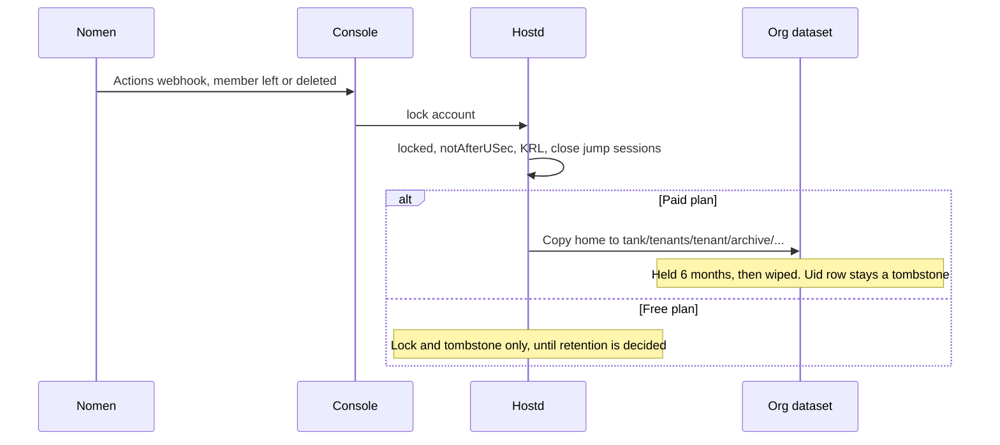
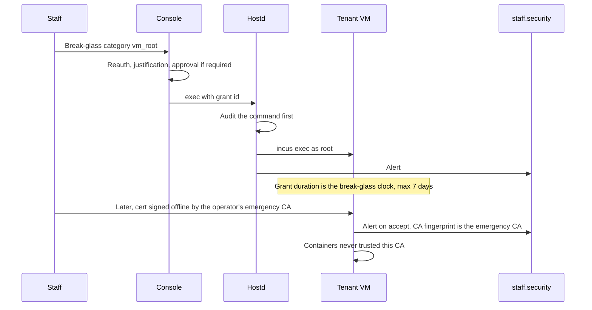

# Local accounts from Nomen

Status: design only, 2026-10-22. Decision owner: the operator Hall.
No code, no migration, and no gold change ships with this document. The next migration number
in this repo would be `029`. That file is not added.

This turns the Nomen/Zitadel research (SSH user certificates, hostd-assigned uids, systemd user
records, container idmaps) into the account design the operator decided. Where the research and a
decision disagree, the decision is the design. Open points are listed at the end and are not
filled in.

Related docs: `docs/plans.md` (Nomen shared / dedicated placement), `docs/architecture/org-storage.md`
(tenant bytes stay on the org dataset; `security.shifted` stays off), `docs/design/devspace-vm.md`
(desktop placement still open; no desktop install).

## 1. What this is

A person signs in through Nomen, picks one org, and receives a short-or-configured-lifetime SSH
user certificate for that context. hostd has already allocated a Linux uid for the pair
`(issuer, subject, org)` and pushed a systemd user record into the places that person is allowed
to enter. A jump host on the edge is the SSH front door. The certificate's key id is what audit
and the console's live sessions view show.

Two online SSH certificate authorities:

| CA | Who it signs for | sshd that trusts it |
|---|---|---|
| Platform | shippin.cloud staff, for the control plane and for tenant VMs | Jump host, tenant VM |
| Tenant | Members of a customer org, for that org's containers | Jump host, those containers |

A third key, the offline emergency CA, is held by the operator and is not one of those two. Section 10.

Staff access to a tenant VM uses the platform CA. A tenant owner or admin does not get sudo on
the VM. A member gets sudo only inside a container they belong to. That sudo is container root
through the unprivileged idmap. It is not root on the VM and not root on gold.

## 2. Decisions applied

1. **Two online SSH CAs.** The research described one step-ca user CA. The design has two
   authorities, because one step-ca configuration has one SSH user key. The platform authority
   signs staff. The tenant authority signs org members. A certificate from one is rejected by
   sshd that trusts only the other.
2. **Jump host on the edge.** Human SSH to a tenant ends at the jump host first. The certificate
   key id carries the Nomen `sub`, the session id, the readable username, and the org. sshd logs
   that key id. The console live sessions view shows the same fields. The key id does not carry
   the email address.
3. **Certificate lifetime is per org and per user.** Presets: 1 hour, 1 day, 1 week, 1 month,
   120 days, and custom. The org admin sets the default and the maximum. The platform absolute
   maximum caps every org. Custom is a duration the admin enters, still under both caps. The
   person may pick a shorter lifetime than the org default at issue time.
4. **Sudo stays inside the member's containers.** Workspace membership is the meaning of "their
   own" used here: sudo is written into the user record of a container only when that person is a
   member of that workspace. An org owner does not gain sudo on the VM, and does not gain sudo in
   someone else's workspace. Staff reach the VM with the platform CA.
5. **Readable usernames. Emails masked.** The Linux username is chosen for that org, lowercase,
   matching `^[a-z][a-z0-9-]{0,31}$`. The email is display-only and every console surface renders
   it as `*****` until the viewer uses the eye control. That reveal is audited. At login the
   person states the org, by slug (`wiredfront` for the operator's org). One inbox can be staff support
   on shippin.cloud and a member of wiredfront. Those are two logins, two principals, and two CAs.
   Infrastructure ownership of the control plane is a service identity. The proposed address is
   `cloud@shippin.cloud`. That address is a proposal until the operator confirms it.
6. **Vaultix holds secrets. A PIN unlocks the human keyring. An AI identity fetches secrets
   without a person present.** See section 8. Nomen's own AI-identity write-up was not readable
   from this environment (`gh` returns 403 for the org). The in-repo sketch is
   `internal/config/agents.go`: IdP service users now, Nomen token exchange with `act` later,
   never a user's raw token. `internal/db/migrations/021_agents.sql` already stores
   `agent_identities` that way.
7. **Paid offboarding keeps an archive for 6 months, on that org's dataset, then deletes it.**
   Rows from different orgs are not combined into one archive tree. Free-tier retention is not
   decided.
8. **Provisioning default is push on the major events, with a JIT fallback and a nightly
   reconcile.** Events: join, leave, role change, deactivate, delete. An org may switch *join*
   to JIT-only. Leave, role loss, deactivate, and delete stay push. Nothing can turn revocation off.
9. **Two emergency paths.** (a) hostd `incus exec` into the tenant VM as root, through the
   existing break-glass grant, audited and alerted. (b) the operator's offline emergency SSH CA key.
   Approval and alerting for both are in section 10.
10. **One trusted step-ca provisioner per Nomen instance.** Tiers in `docs/plans.md`: free and
    starter share an instance, pro is a dedicated virtual instance, business and founder are a
    dedicated deployment. Each instance is its own OIDC provisioner. A token is accepted only
    when its issuer matches that provisioner. The account key stays `(iss, sub, org_id)`.

Reading of decision 10 that this doc uses: `sub` on the *provisioner* row is the OIDC client of
that Nomen instance, and `sub` on the *account* row is the person. One provisioner per human
would contradict "one provisioner per instance". If the operator meant the human `sub`, the provisioner
table in section 11 is wrong and needs his correction.

## 3. What already exists, and what it stays

The MCP bridge already has an SSH user CA.

- `internal/sshca` signs one principal, the workspace id.
- `internal/config/bridge.go` caps that certificate at 60–3600 seconds and the device session at
  1–24 hours.
- `internal/api/bridge_cert.go` puts the account id, the **email**, and the session id in the key id.
- `internal/hostd/bridge_ca.go` installs `TrustedUserCAKeys` and an `AuthorizedPrincipalsFile`
  for the single workspace user (`dev`, uid 1000 in the agent and git paths).

That CA stays the bridge CA. It is not the platform CA and not the tenant CA. Its TTL cap stays
at one hour. This design does not lengthen it to the org presets. The email inside today's bridge
key id is visible to anyone who can read the certificate (`ssh-keygen -L`) or the sshd log. New
account certificates omit the email. Changing the bridge key id is a later code change, called
out so it is not forgotten.

Break-glass today is a console grant, not a root shell. `POST /v1/operator/break-glass` requires
`access.breakglass`, a category, a fresh IdP login, and a justification (`internal/config/access.go`,
`internal/api/access_operator.go`). The configured duration is 1 hour. The code rejects any access
duration above 7 days (`maxGrant`). Customer notice is mandatory; only `legal_hold` may delay it.
Approval, when the team settings require it, is `access.approve_breakglass`. Section 10 adds a VM
root exec on top of that grant. It does not create a second approval system.

There is no guest agent daemon in the tree. hostd already writes files with `incus exec` and
`incus file push` (tenant VM init, bridge CA, workspace work). Account records use that channel
until a probe says a bind mount is enough.

Workspace and tenant projects already set `security.idmap.isolated=true`
(`internal/hostd/inner_project.go`, `internal/hostd/tenant.go`). Containers stay unprivileged.
`ai.volume_shifted` stays false.

## 4. Login, principals, and the two contexts

The person picks the context before a certificate is issued.

- Staff support: context `shippin-staff`. Platform authority. Principal `staff:<username>`.
- An org: context is the slug, stored lowercase (`wiredfront`). Tenant authority. Principal
  `org_<orgId>:<username>`. The org id is the stable Nomen org id. The slug is the name humans
  type and the name that shows up in the key id. A slug rename does not change the principal.

`jessay@gmail.com` as staff and as a member of wiredfront holds two sessions. The staff session
cannot present a tenant principal, and the wiredfront session cannot present a staff principal.
The console does not show both powers on one screen. Switching context starts a new login against
the matching authority.

On a shared Nomen instance the human `sub` is often the same in both orgs. The uid table still
has two rows, because `org_id` differs. On a dedicated deployment the issuer differs, so the row
differs even when the inbox is the same. The console may mention the other context only while the
viewer is in the staff context.

`cloud@shippin.cloud` (proposal) is a service account that owns control-plane resources in Nomen.
It is not a staff login, not a tenant member, and it has no uid in a tenant VM. It does not hold
the offline emergency key.

Usernames are unique per org. The email local-part may be offered as a suggestion. It is stored
only when it matches the username rule. The gold host's `login.defs` is not used for these
accounts. hostd is the only allocator.

## 5. Certificate policy

| Knob | Who sets it | Bound |
|---|---|---|
| Preset or custom duration at issue | The person, up to the org max | Under the org max |
| Org default and org max | Org owner (Nomen `ORG_OWNER`; org admin if that role exists on the fork) | Under the platform absolute max |
| Platform absolute max | Platform config, the operator | Unset. See the open list |

Presets the UI offers: `1h`, `24h`, `168h`, `720h` (30 days), `2880h` (120 days), custom.
step-ca's own documented default of 16 hours is not the policy.

The platform absolute max is not in the decisions. Proposal, until the operator picks a number: the
absolute max is 120 days, matching the longest preset, and custom cannot exceed it. 120 days is
long enough that a lost laptop is a revocation problem, not an expiry problem. Revocation is
mandatory at that lifetime: a locked user record makes `AuthorizedPrincipalsCommand` return
nothing, and the certificate serial is added to the KRL (`RevokedKeys`) on the jump host, the VM,
and the containers. A nightly reconcile repairs a missed KRL push.

Host certificates are the pair of each authority. The jump host's host certificate comes from the
platform host CA, so clients pin one host. Containers' host certificates come from the tenant host
CA. The jump host checks the container host certificate before it proxies. Members do not open
container SSH to the internet. The jump host is the only human SSH path.

The exact step-ca template syntax was not in the research dump (the principals section of the
saved SSH login page did not include a template). The claims the template must read are: `iss`,
`sub`, the chosen org id, the username, and the session id. Confirm the template language when
phase 2 is built. Do not guess a template in code before that.

## 6. Uids and idmaps

hostd is the source of truth. The table is `(iss, sub, org_id) -> (uid, username)`.

| Rule | Value |
|---|---|
| Member range, inside one org | 10000–59999, sequential, per org |
| gid | equal to uid (private group, group name = username) |
| Reuse | never. A tombstone row holds the uid after archive and after wipe |
| Exhaustion | fail closed. The org gets no more accounts |
| Where the range is written | Inside that org's VM and its containers. Not in gold's `/etc/passwd` |

Each org starts at 10000. uid 10000 in wiredfront and uid 10000 in another org are different
people. They never share a VM (starter and above are one VM per org) and they never share a
volume (`docs/architecture/org-storage.md`). Free-tier containers run on gold, in project
`t-<tenant>`, still isolated from other tenants. Their user records live inside the container,
not as gold host accounts.

Why this range: systemd dynamic users are 61184–65519, and an isolated container idmap is a
window of `security.idmap.size` (Incus default 65536) starting at a base at or above 65536.
10000–59999 sits under both, so a container uid in this range is inside the default idmap window.
Do not shrink `security.idmap.size` below 65536. Do not allocate a member uid at or above the
idmap size.

The range also sits inside the usual `login.defs` human band (UID_MIN 1000, UID_MAX 60000).
`useradd` on the VM could pick the same number. The guest image change, when this is built, pins
`UID_MAX` below 10000 so `adduser` cannot enter the band. The existing workspace user `dev` at
uid 1000 stays. hostd remains the only writer of 10000–59999.

Worked example. wiredfront, username `operator`, uid 10000, gid 10000.

- Inside container A the account is uid 10000.
- Incus isolated base for A might be 65536. On the VM the mapped id is 75536.
- Container B, base 131072, maps the same inner uid to 141072.
- A volume created without `security.shifted` stores owner 75536. Container B then sees the files
  as `nobody`. `security.shifted=true` is what makes both containers see owner 10000.
- That property stays off. The host ZFS probe is already written in
  `docs/architecture/org-storage.md` and has not been run. The inner pool is btrfs, named
  `default`, on Incus 6.0.6 inside the VM. Shifted-on-btrfs there is a separate probe (section 13).
  Until both probes pass, a member's files live on the per-workspace home `h-<uuid>`, attached to
  one container. Shared org volumes, including a shared `~/.ai`, wait.

Staff shell accounts on the VM are not members, so they should not consume 10000–59999.
Proposal: a platform-wide staff range 7000–7999 on tenant VMs, gid = uid, never reused, sudo
group present, accepted only from the platform CA. the operator did not set this range. If he would
rather staff land as distinct usernames with uids hostd picks another way, the 7000 band goes.

The jump host is shared by every org, so it cannot use per-org uid 10000. It has one local
account, `jump`, with a forced command that proxies and then drops the session. Recognition is
the certificate key id in the sshd log and in the live sessions view. `who` on the jump host is
not the list of tenants.

Key id, one line, no email:

```text
sub=<nomen sub> sid=<session uuid> user=<username> org=<slug>
```

Staff uses `org=shippin-staff`. An emergency certificate prefixes the line with `emergency `.

## 7. User records, sshd, sudo, desktop session

hostd writes a systemd JSON user record:

- `uid`, `gid`, `userName`, `disposition` `regular`
- `memberOf`: `sudo` only in a container where the person is a workspace member. Absent on the VM
  for members. Present for staff accounts on the VM.
- `locked` true on deactivate, leave, and archive
- `notAfterUSec` set to the archive or lock instant (finer than shadow expiry)

Preferred path: `/etc/userdb/<username>.user` on the VM, and the same file pushed into each
container that should see the account. `/run/host/userdb` is the directory `userdbd` also reads.
Whether Incus bind-mounts the VM's `/run/host/userdb` into a container is unverified. The push
does not depend on that mount. If the Debian 13 image has no working `userdbd`, the fallback is
`useradd`/`usermod` with the hostd uid, and `locked` / `notAfterUSec` are emulated by locking the
password and setting account expiry. The probe picks the path. JSON is preferred because those
two fields are the revocation signal `AuthorizedPrincipalsCommand` reads.

Container sshd:

- `TrustedUserCAKeys` = tenant user CA only
- `AuthorizedPrincipalsCommand` prints `org_<orgId>:<username>` only when the local record exists,
  `locked` is false, and `notAfterUSec` is in the future. Any error prints nothing (fail closed).
- `RevokedKeys` = the KRL hostd distributes

VM sshd:

- `TrustedUserCAKeys` = platform user CA and the offline emergency CA public key
- The tenant CA is not in that list, so a member certificate cannot open a shell on the VM
- Staff principals get sudo. Member accounts may exist on the VM for a desktop PAM session and
  are not in `sudo`

Jump host sshd:

- Trusts the platform user CA, the tenant user CA, and the emergency CA public key
- Forced command on user `jump`: check the principal, write the live-session row, proxy to the
  allowed target, close when the certificate expires or the session is revoked
- A tenant principal may be proxied only to containers of that org. A staff principal may be
  proxied only to tenant VMs. An emergency principal follows the staff target list and raises
  the alert in section 10.

Desktop session, when a placement is chosen later. This document does not install Claude Desktop,
Codex desktop, or Grok desktop, and does not choose control plane versus tenant VM.

The intended broker is Caddy `forward_auth` to the console, then a `selkies@<username>.service`
with `PAMName=` so the session is a real PAM session for that user record. The dumped Selkies
settings page did not contain `PAMName`; treat the knob as the intended setting and confirm the
current Selkies name before building it. The service runs as the member uid, without sudo on the
VM. Electron apps in that session are started with `--password-store=gnome-libsecret`. Electron's
safeStorage falls back to a hardcoded password when no secret store is available, which means the
items are not secret. The session refuses to start those apps until the gnome-keyring is unlocked
(section 8).

## 8. PIN, keyring, AI identities

### PIN

The PIN is a human factor for the desktop keyring. It is not required to issue an SSH
certificate in this design. SSH and the keyring are different doors. If the operator wants the PIN
before a certificate is signed, that is a change to section 5.

- The PIN is never stored, never logged, never put in a process argument, and never written into
  an audit detail. Audit records `pin_set`, `pin_ok`, or `pin_fail` plus the attempt count.
- At setup, over a fresh Nomen login, the console generates a random keyring passphrase and stores
  it in that user's Vaultix path (`<org section>/users/<sub>/keyring-passphrase`). The passphrase
  is the gnome-keyring secret. The PIN is the factor that releases it.
- The console stores an Argon2id verifier (salt, hash, parameters) and lockout state
  (`failed_attempts`, `locked_until`). It does not store a column that can be reversed into the PIN.
- Proposal for the stretch: Argon2id, 64 MiB, parallelism 1, time cost tuned so a check takes
  roughly a quarter-second on the console. Proposal for lockout: 5 failures locks for 15 minutes,
  then the lock doubles, capped at 24 hours. The 10th failure alerts the person and the org owner.
- A successful check returns a single-use ticket, proposal 60 seconds, bound to the console
  session. The desktop broker redeems the ticket. The console reads the passphrase from Vaultix
  with the user's Nomen token and hands it to the broker on that channel. The broker unlocks
  gnome-keyring on stdin of the daemon, then zeroes the buffer. Vaultix down means the keyring
  stays locked and Electron apps stay refused. SSH through the jump host still works.

Vaultix placement follows `docs/plans.md`: free and starter are a section in the shared cluster;
pro and above are dedicated. The passphrase lives in the org's own section either way.

### AI identity

Permanent non-interactive access is a machine identity in a category named `ai`, not a 120-day
SSH certificate and not the human PIN.

- One identity per agent, and one per user who needs an agent to act while they are away. The
  existing `agent_identities` row grows a kind (`agent` or `user_machine`), a Vaultix identity id,
  `rotated_at`, and `revoked_at`. Tool grants still only narrow what the delegating user holds.
- Scope is that org's Vaultix section, and only the paths the delegating user granted. No
  cross-org path, no staff path, no platform CA, no sudo, no uid in the 10000–59999 band.
  Proposal for v1: the process keeps running as the workspace user `dev` (uid 1000). A separate
  Linux uid for agents is not part of this design.
- Authentication is Nomen token exchange (RFC 8693), as `agents.go` already describes. The
  exchanged token carries `act` for the delegating user. The agent does not use the human's
  access token or refresh token. Zitadel's published exchange issues opaque access tokens and
  does not issue a refresh token from the exchange; the agent exchanges again when the access
  token expires. Zitadel recommends confidential clients only. Whether the Nomen fork enables
  token exchange, the device grant, and Actions v2 is unverified (section 13).
- Rotation, proposal: access tokens live as long as Nomen allows (minutes, not months); the
  machine credential (private key JWT) rotates every 90 days. Revocation disables the Nomen
  service user, revokes the Vaultix identity, and writes the audit row. It does not depend on a
  certificate expiring.
- The AI identity cannot read the gnome-keyring and cannot complete a PIN prompt.

## 9. Provisioning and offboarding

### Push, JIT, nightly

Default, and the platform default an org cannot weaken:

| Event | Action |
|---|---|
| Join | Push the user record. Org may set join to JIT instead |
| Role change | Push `memberOf` again. A lost workspace membership drops sudo in that container |
| Leave, deactivate, delete | Lock the record, set `notAfterUSec`, append the KRL, close jump sessions |
| Login | JIT: if the row is missing or the guest record is missing, create it before the certificate is signed |
| Nightly | Reconcile Nomen membership against `linux_accounts` and the guest records. Repair drift. Page if a departed member was still unlocked |

Nomen Actions v2 calls a console webhook. hostd is not exposed to Nomen. The console checks the
webhook signature and then calls hostd on its unix socket. The research dump did not include the
fork's event type strings. Subscribe by meaning (membership, role, deactivation, deletion) and
confirm the names on the fork before phase 4. A missed webhook is why the nightly job exists.

### Archive

Paid plans (starter, pro, business, and the internal founder plan): on delete or account closure,
copy that person's home and the user-record snapshot to
`tank/tenants/<tenant>/archive/<iss>/<sub>/<org_id>/`. The Postgres row stores the path, the byte
count, `archived_at`, and `delete_after` (archived_at + 6 months). It does not store the file
bytes. The uid row becomes `archived`, then `tombstone` after the wipe. The uid is never returned
to the counter.

The copy stays on that org's dataset. It is not moved to a platform pool and not mixed with
another tenant. Dedicated Vaultix data is exported into the same directory before the Vaultix
identity is removed. Shared-cluster Vaultix (free/starter) is exported the same way, then removed
from the shared section so the shared database is not the long-term archive.

Free-tier retention is an open question. Do not implement a number. The options the operator is choosing
among are: the same 6 months, a shorter archive, or delete on leave with only the tombstone kept.
Until he chooses, a free-tier delete locks the account and keeps the tombstone, and does not start
a 6-month archive job.

## 10. Emergency access

### (a) hostd `incus exec` as root

This extends the current break-glass grant. It does not bypass it.

1. Staff with `access.breakglass` request break-glass as they do now: category, justification
   (minimum length from config, 20 characters today), IdP login within `reauth_minutes` (10 today).
2. A new category `vm_root` means "root exec on this tenant's VM". Customer notice follows the
   existing rules, including the `legal_hold` delay. The duration stays the break-glass duration
   (1 hour in config, hard cap 7 days in code). That cap is a different clock from SSH certificate
   presets. A 120-day SSH certificate does not lengthen a break-glass grant.
3. When team settings require an approver, `access.approve_breakglass` decides, as today.
   Whether break-glass always needs a second person is still open in
   `docs/architecture/staff-roles/questions.md`.
4. Only while that grant is `approved` and unexpired, the console may call
   `POST /tenants/{t}/break-glass/exec` with the grant id and the command. hostd checks the grant
   with the console's signature, writes the audit row (actor, tenant, command argv, grant id)
   **before** it runs, then `incus exec tvm-<tenant> --` as root. Interactive exec is allowed
   inside the grant window and is closed when the grant ends. The command is alerted to
   `staff.security` when it starts. The customer banner is the existing notice.

A grant that is not `vm_root` cannot call this route. The route does not exist for tenant owners.

### (b) Offline emergency CA

A third SSH user CA. It is not a copy of the platform CA private key and it is not loaded into
step-ca. If the operator instead wants a sealed duplicate of the platform key, that is a different
design (one key, two copies) and the trust rules below change.

- the operator holds the private key. No second holder is named. Where it lives is his call. Proposal:
  an encrypted hardware token in his possession, not on gold, not in the repo, not in hostd config.
- The public key is installed in `TrustedUserCAKeys` on the jump host and on tenant VMs, beside
  the platform CA. Containers do not trust it.
- Use: write the reason first (same justification minimum as break-glass). When a second staff
  owner exists, that person witnesses. Today the staff-role questions still ask who besides the operator
  is an owner, so single-holder use is the current fact and must be obvious in the alert.
- Certificates this key signs are short. Proposal: 1 hour, not the org preset, and not 120 days.
  Key id starts with `emergency` and still carries `sub`, `sid`, `user`, and `org`.
- Alerting: the jump host and the VM recognise the CA fingerprint and page `staff.security` plus
  the org owner at the moment the certificate is *accepted*. Signing happens offline, so the
  page cannot fire at signing time. A paper log when the token is taken out is part of the
  procedure. Customer notice uses the same banner as break-glass, dated from acceptance.
- Revoking the CA itself: remove the public key from every jump host and VM, and publish a KRL
  for anything it already signed. That rotation is a later gold change with a drill. It is not
  this document's deploy.

Compromise of this one offline key bypasses Nomen for VM root. The limits are the short
certificate, the alert on acceptance, container sshd ignoring the CA, and the ability to pull
the public key.

## 11. Data model (sketch only)

Not a migration file. Names are the ones a future `029_linux_accounts.sql` would use. Existing
`agent_identities` and the access-grant tables stay; this adds columns and tables beside them.

```sql
-- Account key is the person at one issuer in one org. uid is never updated and never reused.
CREATE TABLE linux_accounts (
  iss         text NOT NULL,
  sub         text NOT NULL,
  org_id      text NOT NULL,
  org_slug    text NOT NULL,
  uid         integer NOT NULL CHECK (uid BETWEEN 10000 AND 59999),
  gid         integer NOT NULL CHECK (gid = uid),
  username    text NOT NULL CHECK (username ~ '^[a-z][a-z0-9-]{0,31}$'),
  state       text NOT NULL CHECK (state IN ('active','locked','archived','tombstone')),
  archived_until timestamptz,
  created_at  timestamptz NOT NULL DEFAULT now(),
  PRIMARY KEY (iss, sub, org_id),
  UNIQUE (org_id, uid),
  UNIQUE (org_id, username)
);

CREATE TABLE linux_uid_counters (
  org_id   text PRIMARY KEY,
  next_uid integer NOT NULL CHECK (next_uid BETWEEN 10000 AND 60000)
);

-- Staff VM uids, only if the 7000-7999 proposal is accepted.
CREATE TABLE staff_vm_accounts (
  iss      text NOT NULL,
  sub      text NOT NULL,
  uid      integer NOT NULL CHECK (uid BETWEEN 7000 AND 7999),
  username text NOT NULL,
  PRIMARY KEY (iss, sub),
  UNIQUE (uid)
);

CREATE TABLE ssh_cert_policies (
  org_id      text PRIMARY KEY,          -- 'platform' holds the absolute max
  default_ttl interval NOT NULL,
  max_ttl     interval NOT NULL,
  CHECK (default_ttl > interval '0' AND default_ttl <= max_ttl)
);

CREATE TABLE ssh_user_cert_prefs (
  iss text NOT NULL, sub text NOT NULL, org_id text NOT NULL,
  ttl interval NOT NULL,
  PRIMARY KEY (iss, sub, org_id)
);

-- One row per Nomen instance. client_id is the reading of decision 10's provisioner sub.
CREATE TABLE ssh_provisioners (
  id          uuid PRIMARY KEY,
  ca          text NOT NULL CHECK (ca IN ('platform','tenant')),
  placement   text NOT NULL, -- shared_instance | dedicated_virtual_instance | dedicated_deployment
  issuer      text NOT NULL,
  client_id   text NOT NULL,
  UNIQUE (issuer, client_id)
);

CREATE TABLE ssh_live_sessions (
  id          uuid PRIMARY KEY,
  ca          text NOT NULL,
  cert_serial text NOT NULL,
  nomen_sub   text NOT NULL,
  session_id  text NOT NULL,
  username    text NOT NULL,
  org_slug    text NOT NULL,
  jump_host   text NOT NULL,
  source_ip   text NOT NULL,
  opened_at   timestamptz NOT NULL DEFAULT now(),
  last_seen   timestamptz NOT NULL DEFAULT now(),
  expires_at  timestamptz NOT NULL,
  closed_at   timestamptz
);

CREATE TABLE ssh_revocations (
  ca          text NOT NULL,
  cert_serial text NOT NULL,
  reason      text NOT NULL,
  revoked_at  timestamptz NOT NULL DEFAULT now(),
  PRIMARY KEY (ca, cert_serial)
);

CREATE TABLE pin_verifiers (
  iss text NOT NULL, sub text NOT NULL, org_id text NOT NULL,
  argon2_salt bytea NOT NULL,
  argon2_hash bytea NOT NULL,
  argon2_params jsonb NOT NULL,
  failed_attempts integer NOT NULL DEFAULT 0,
  locked_until timestamptz,
  PRIMARY KEY (iss, sub, org_id)
  -- no pin, no passphrase
);

CREATE TABLE account_archives (
  id           uuid PRIMARY KEY,
  iss text NOT NULL, sub text NOT NULL, org_id text NOT NULL,
  dataset_path text NOT NULL, -- tank/tenants/<tenant>/archive/...
  bytes        bigint NOT NULL,
  archived_at  timestamptz NOT NULL,
  delete_after timestamptz NOT NULL,
  wiped_at     timestamptz
);

-- Extend agent_identities (021): kind, vaultix_identity_id, rotated_at, revoked_at.
-- Extend break-glass grants with category vm_root; do not add a second grant table.
-- Org provisioning knob: join_mode 'push' (default) or 'jit'. Not a way to disable revoke.
```

Emails stay in Nomen. The console mask is a view. Audit rows may store the address for an
investigation; the console still renders `*****` until a reveal. Reveal of someone else's email
needs a reason and a permission narrower than `identity.read`. Proposal: the person may reveal
their own address; staff need a new permission `identity.reveal_email`.

## 12. APIs (sketch only)

hostd, unix socket, same style as `/tenants/{t}/storage`. The console is the only caller.

| Method | Path | Behavior |
|---|---|---|
| POST | `/tenants/{t}/accounts/ensure` | JIT. Body: iss, sub, org id, slug, username. Allocates the uid once. Pushes the user record. |
| POST | `/tenants/{t}/accounts/lock` | Sets `locked` and `notAfterUSec`, returns serials to revoke. |
| POST | `/tenants/{t}/accounts/archive` | Copies the home onto the org dataset, then locks. Paid plans only until free retention is set. |
| POST | `/tenants/{t}/accounts/reconcile` | One org, or all orgs when the nightly job calls it. |
| POST | `/tenants/{t}/break-glass/exec` | Body: grant id, command. Audit first. Root `incus exec` only for an approved `vm_root` grant. |
| POST | `/tenants/{t}/krl` | Install the KRL on the jump path, the VM, and current containers. |

Console, in front of those calls:

| Method | Path | Behavior |
|---|---|---|
| POST | `/v1/orgs/{slug}/session` | Records the chosen context and starts OIDC against the matching provisioner. |
| GET | `/v1/me/sessions` | Live jump sessions for this person. Emails masked. |
| GET | `/v1/operator/sessions` | Staff view of live jump sessions. |
| PUT | `/v1/orgs/{org}/cert-policy` | Org default and max. Rejected above the platform absolute max. |
| PUT | `/v1/orgs/{org}/members/{sub}/cert-policy` | Personal preference, under the org max. |
| POST | `/v1/me/email/reveal` | Returns the address, writes an audit row. |
| POST | `/v1/me/pin` | Set or replace. Requires a fresh login. |
| POST | `/v1/me/pin/verify` | Rate limited. Returns the single-use unlock ticket. |
| POST | `/v1/orgs/{org}/ai-identities` | Creates the Nomen service user and the Vaultix AI identity. |
| POST | `/v1/orgs/{org}/ai-identities/{id}/rotate` | Rotates the machine credential. |
| POST | `/v1/orgs/{org}/ai-identities/{id}/revoke` | Disables it. |
| PUT | `/v1/orgs/{org}/provisioning` | `{ "join": "push" \| "jit" }` only. |
| POST | `/v1/webhooks/nomen` | Actions v2. Signature checked. Then hostd. |

Existing `POST /v1/operator/break-glass` gains category `vm_root`. Existing bridge certificate
routes are unchanged.

## 13. Sequences

### Login and SSH

```mermaid
sequenceDiagram
  participant User
  participant Console
  participant Nomen
  participant Step as step-ca tenant authority
  participant Hostd
  participant Jump as Jump host
  participant Box as Container sshd

  User->>Console: Choose slug wiredfront
  Console->>Nomen: OIDC for that org only
  Nomen-->>Console: Token iss, sub, org
  Console->>Hostd: ensure account
  Hostd-->>Console: uid, username, record pushed
  Console->>Step: Sign on the provisioner pinned to this issuer
  Step-->>User: Cert principal org_id:username, key id without email
  User->>Jump: SSH to the jump host
  Jump->>Jump: Log key id, open live session
  Jump->>Box: Proxy only into this org
  Box->>Box: Tenant CA trusted, principals command reads user record
  Box-->>User: Shell as uid, sudo if workspace member
```

A staff login uses the platform authority and is proxied to the VM, not into a customer container.

### Leave and archive



### Break-glass and the offline CA



## 14. Unverified, needs a gold or fork probe

Nothing in this list was checked on gold. Do not flip a flag because this document describes the
desired end state.

| Item | Why it matters | What to run or read |
|---|---|---|
| `security.shifted` on the **inner** btrfs pool, Incus 6.0.6 inside the tenant VM | Shared org volumes between isolated containers. Distinct from the host ZFS probe already written in `docs/architecture/org-storage.md`. | On a throwaway tenant, inside the guest: create a 1 GiB custom volume on pool `default` with `security.shifted=true`, attach it to two `security.idmap.isolated=true` containers, confirm uid 10000 in each sees the files as itself. Quote the error if create fails. Delete the volume. Leave `ai.volume_shifted` false. |
| Host ZFS `security.shifted` on `p-<tenant>` | Same property for free-tier containers that live on gold, and for `~/.ai` if it stays a host volume. | The commands already in `docs/architecture/org-storage.md`. |
| `/run/host/userdb` inside an Incus container | Whether one user record on the VM appears in every container without an explicit push. | On a throwaway container, see if `/run/host/userdb` is mounted and if `userdbctl` shows a record placed only on the VM. The design's explicit `incus exec` push does not wait on this. |
| Debian 13 `userdbd` on the guest image | JSON records with `locked` and `notAfterUSec` need `userdbd`. The research man page is systemd 262. Gold's systemd may differ. The image today is the tenant VM image plus `shippin/dev-debian13-ai1` for workspaces. | `systemctl status userdbd` and `userdbctl user` inside the VM and inside a workspace container. If the unit is absent, phase 1 uses the `useradd` fallback. |
| Nomen fork: Actions v2 | Webhook event names were not in the saved Zitadel page (`user.human` did not appear). | On the fork, list the event types for membership, role, deactivation, and delete, and the webhook signature. |
| Nomen fork: token exchange | Public Zitadel docs describe RFC 8693, opaque access tokens, no refresh token from the exchange, confidential clients. The fork may differ. `agents.go` already commits to `act` and forbids the user's raw token. | Confirm the grant is enabled and that `act` survives. |
| Nomen fork: device grant | The bridge already has its own device-code table (`022_bridge.sql`). That is not automatically the Nomen device grant. | Confirm whether the fork's device grant is on, and leave the bridge flow alone either way. |
| Nomen AI-identity docs | Not read. `gh` on this environment returns 403 for the org. | Someone with repo access should point at the token-exchange / workload-identity page if it exists, and this section should be corrected to match it. |
| step-ca principals template | The saved SSH login page did not include template syntax. | Read the step-ca version we would pin and record the template that emits one principal and the key id from section 6. |
| Selkies `PAMName=` | Not present in the dumped settings page (that page redirected). | Confirm the current unit setting that opens a real PAM session as the member uid. |

## 15. Build phases

No phase starts in this change. Each phase that writes code stays behind a flag defaulting off,
the way `agent.session_manager` does. Gold is not a target of any phase until the operator says so.

| Phase | Delivers | Waits on |
|---|---|---|
| 0 | This document | |
| 1 | `linux_accounts`, the uid counter, tombstones, JSON user-record push through `incus exec`, lock and `notAfterUSec`. No CA cutover. Per-workspace homes only. | Debian 13 `userdbd` probe. Fallback is `useradd` with the same uids. |
| 2 | Two step-ca authorities. One tenant provisioner per Nomen instance. Jump host, live sessions, key id format from section 6. Bridge CA untouched, including its one-hour cap. | Template syntax. Decision 10's `sub` reading. the operator confirms `cloud@shippin.cloud` or replaces it. |
| 3 | Cert policy API and UI. Presets, org default, org max, platform absolute max. Principals command. KRL. | the operator's absolute max. Proposal is 120 days. |
| 4 | Nomen webhook to the console, push on leave/role/deactivate/delete, JIT ensure, nightly reconcile, join mode. | Actions v2 event names on the fork. |
| 5 | Sudo group only in containers the member belongs to. VM sshd trusts the platform CA only. | Staff uid range (7000–7999 is a proposal). |
| 6 | PIN verifier, lockout, keyring unlock ticket, Vaultix passphrase path. AI identities as an extension of `agent_identities`, token exchange with `act`. No desktop install. Electron apps refused while the keyring is locked, once a desktop placement exists. | Vaultix AI category confirmed. Token-exchange probe. Desktop placement stays open in `docs/design/devspace-vm.md`. |
| 7 | Paid archive on `tank/tenants/<tenant>/archive/...`, 6-month wipe, tombstone kept. | Free-tier retention. Shifted probes before any shared home is part of the archive source. Per-workspace homes can be archived without shifted. |
| 8 | `vm_root` break-glass category and hostd exec. Emergency CA **public** key on the jump host and VMs, alert on accept. Private key never in the repo. | the operator confirms the third-CA reading, custody, and the 1-hour emergency certificate. |

## 16. Needs the operator's call

These are inconsistent, unspecified, or only a proposal. They are not decided by this document.

1. **Platform absolute max certificate lifetime.** Presets include 120 days and custom. No absolute max was set. Proposal: 120 days.
2. **Free-tier retention.** Paid is 6 months on the org dataset. Free is explicitly open.
3. **`cloud@shippin.cloud`.** Proposed service identity for control-plane ownership. Not confirmed.
4. **Decision 10's `(iss, sub)`.** This doc treats the provisioner's `sub` as the OIDC client id of that Nomen instance, and the human `sub` as part of the account key. Confirm or correct.
5. **Offline CA shape.** This doc makes it a third CA, public key trusted by the jump host and the VM, certificates it signs limited to 1 hour (proposal), private key only with the operator. Confirm that is what "offline emergency SSH CA key" means, name any second holder, and name where the token lives.
6. **"Their own containers."** Read here as workspace membership, not sudo in every container in the org. Confirm.
7. **Staff uid band 7000–7999** on the VM. Invented so staff do not consume the member range. Reject or replace.
8. **PIN versus SSH.** The PIN unlocks the keyring only. SSH certificates are issued without it. Say if the PIN must gate SSH too.
9. **Break-glass second person.** Still open in `docs/architecture/staff-roles/questions.md`. `vm_root` inherits that gap. Also confirm customer notice for a root exec should keep today's banner, including `legal_hold` delay.
10. **Bridge key id contains the email today.** New certificates omit it. The bridge CA is a leftover until someone changes `internal/api/bridge_cert.go`.
11. **`security.shifted`.** The research baseline turns it on. The repo keeps it off until the gold probes pass. Shared homes cannot ship before that. Per-workspace homes can.
12. **AI Linux uid.** Proposal: no uid in v1; agents run as `dev` and authenticate to Vaultix with the AI identity.
13. **PIN lockout numbers, Argon2 parameters, 60-second unlock ticket, 90-day machine-credential rotation.** All proposals.
14. **Same person, two issuers.** Dedicated Nomen means a different `iss` and a different uid row for the same inbox. The staff context is the only place the console links them. Confirm that is the separation you want for `jessay@gmail.com` plus wiredfront.
15. **Nomen workload-identity docs.** Not readable here. If they already specify the exchange, phase 6 should follow them instead of the Zitadel public matrix.
