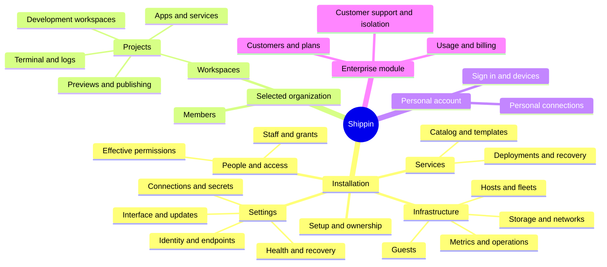

# Deployable foundation and panel organization

Implementation plan, grounded on `bb340c33f0b77c1c8c7225d8dae20e1755dd6c28`,
2026-11-20. **Planned, not implemented or live-provider verified by this document.**
The immediate milestone is: install, open the chosen hostname, claim ownership,
attach a host, and operate a real workload through the existing panel.

The [objective](objective.md) remains the product contract,
[source ownership](source-of-truth.md) names current owners, the
[code map](architecture.md) names target contexts, and the
[roadmap](roadmap.md) owns sequencing. This document supplies the execution packets
and their acceptance gates. It does not create another product definition.

## What the code actually supplies

| Evidence inspected | Existing behavior | Consequence for implementation |
| --- | --- | --- |
| `install/docker/configure.py`, `entrypoint.sh`, `install/panel/render-config.py`, `compose.yaml` | Compose credentials are generated only when missing; persistent session key and TLS files; setup code issuance; hostname/origin supplied through environment. | Complete and validate this path. Keep local binding as a safe default; make internal or public exposure an explicit choice. |
| `entrypoint.sh` | Generated certificates are reused merely because the files exist; SAN generation distinguishes a numeric IPv4-like string from a DNS name. | Cover hostname changes, IPv6, expiry and incomplete pairs; never overwrite owner-supplied certificates. |
| `internal/app/app.go` | One composition root starts API, identity, jobs and background services; module migrations and registry already exist. | Extend the existing startup. Do not introduce another server or universal service container. |
| `internal/platform/setting/{setting,update}.go` | Registered settings use the existing store, version checks and secret-store path. | Add owner-declared sections; no separate settings database or frontend-only configuration. |
| `internal/hv/{driver,catalog}.go` | Drivers expose typed operations, capabilities, create fields, observations and explicit unsupported errors. | Improve capability and operation truth in these contracts; avoid provider conditionals in every page. |
| `web/src/lib/router/{meta,nav}.ts`, generated route files and `web/scripts/routes.mjs` | Folder-derived routes/navigation, stable entry IDs, lazy pages and module routes already exist. | Extend that generator and its tests. No new routing library or hand-maintained route registry. |
| `web/src/app/require-auth.tsx` | Every `useMe` error redirects to login; landing chooses the first tenant before operator destinations. | Distinguish authentication from outages, and make context selection explicit without inferring staff authority from first membership. |
| `web/src/features/infrastructure/infrastructure/model.ts` | Provider tabs, fleet rows, metrics transforms and forms already have pure model functions. | Retain and split by coherent concern when touched; do not recode those rules in components. |
| `docs/web-framework.md`, `web/package.json`, tracked tree | F1 routes and F5 boundary checks exist. The documented product lexicon and `web/tokens/` generation source are absent. | Treat F4 and F2 generation as planned. Existing CSS tokens and token checks remain useful and mandatory. |

Earlier session probes found an already-claimed local panel with healthy core
dependencies, but its running binary was older than this source baseline. Those
probes do not verify current-main installation or either provider journey. Preserve
that installation's accounts and data; use a separate disposable install for fresh
claim tests. Roadmap entries describing earlier successes are not fresh evidence.

## The product map and the folder map

The user's mental model is the installation and the selected organization. A
workspace groups projects; a development workspace is a compute resource belonging
to a project. These IDs and permissions are distinct.



This is the grouping model, not a promise that every leaf works today. Navigation
only links to implemented destinations. An unavailable capability explains its
prerequisite; an unauthorized resource must not be disclosed. Every destination
remains within four actions (UI-01); use context selection, sections and local tabs
instead of an endlessly nested sidebar.

| Concern | Current owner to extend | Target context and UI ownership |
| --- | --- | --- |
| Process and bootstrap | `internal/app`, `internal/platform/config`, `install/`, root deployment files | Composition and bootstrap stay here; installation behavior belongs to Platform. |
| Claim and account security | `internal/identity`, `internal/api/setup_account.go`, auth/setup features | Identity owns code redemption and accounts; Platform owns setup progress. Access owns caller and authorization. |
| Internal organization links | `internal/tenancy/orgs` | Preserve explicit registry links while moving toward Organizations; never infer staff access from tenant membership. |
| Workspace grouping and projects | `internal/tenancy/projects`, `features/workspaces` | Organizations (`internal/tenancy` target); membership and ancestry stay authoritative here. |
| Hosts, guests and provider IO | `internal/hv`, infrastructure API handlers, `features/infrastructure` | Infrastructure owns orchestration/inventory; `hv/incus` and `hv/proxmox` own protocol details. |
| Catalog and deployment state | `internal/services/catalog`, `internal/services/deployments`, `internal/services/jobs` | Services target context; deployments owns desired/observed state and outbox, jobs owns leases/retries only. |
| Compute workspaces and terminal | Existing runtime handlers, `features/devspaces`, `features/terminal` | Runtime target context; consult organization ancestry and Infrastructure through explicit boundaries. |
| Settings and integrations | `internal/platform`, `internal/settings`, `internal/infrastructure/networking`, existing integration packages | Owner declares its settings; Platform aggregates them. Inventory of a connection is not provisioning. |
| Enterprise behavior | Existing mixed packages, `internal/ext`, `web/src/modules` | Move through S1–S4 into the existing private-module design; core never imports the enterprise module. |

Target ownership does not mean creating empty folders now. Keep one implementation
per concern. The move of an entity includes its storage, callers, tests and contract
in one packet; remove the superseded implementation in that packet.

### Backend shape

Use the existing modular monolith and MCPL entity pattern:

```text
internal/<context>/<entity>/
  <entity>.go       types, invariants and entity storage boundary
  <verb>.go        typed MCPL action
  <verb>_test.go   behavior and authorization failures
  settings.go     only when the entity declares settings
  services.go     only when it declares runtime dependencies
  storage.go      only when persistence warrants its own file
```

Pure rules do not depend on HTTP or a provider client. Actions coordinate those
rules, permissions, transactions and audit through MCPL. External IO is owned by
the provider/integration package. A small dependency interface belongs to its
consumer; a second package does not query the owner's tables. Shared mechanics
remain in existing named packages, not new `common`, `helpers` or `utils` buckets.
Do not require five layers or one folder per trivial function.

**MCPL folder moves can change action IDs and URLs.** Before a move, enumerate the
generated registry, OpenAPI, typed clients, MCP callers and route tests. Preserve
contracts by default; if deliberately changed under PRE-01, update every caller
and generated contract atomically. Do not create compatibility scaffolding merely
to make the folders look uniform. Generated files are never edited by hand.

### Frontend shape and automatic grouping

```text
web/src/routes/<app>/<path>/
  page.tsx         page composition or a thin feature-page export
  layout.tsx       optional shared layout with Outlet
  meta.ts          stable navigation ID, section, order and capability
web/src/features/<context-or-existing-feature>/
  index.ts         deliberate public exports
  api.ts           feature calls and query keys
  model.ts         pure transformations and validation
  ui/              named components, grouped by entity as needed
```

Use existing feature names until their owning packet moves them. Route folders own
URLs/layouts/navigation; feature folders own reusable domain UI and behavior;
`lib/design` owns reusable primitives; `template` owns shell presentation. Move
domain hooks out of the broad `lib/hooks` collection when working on that domain,
without reversing the existing dependency rule that `lib` cannot import features.

Extend the current section metadata and generator checks to implement the product
map. Keep stable navigation IDs and saved `ui.nav` overrides. Section labels/order
get one definition consumed by the existing console/admin shells; route entries
stay beside their pages. Product labels use the existing `ui.text`/`ui.providers`
configuration. New lexicon tooling must be implemented and checked before any
packet relies on it. A user's configured label does not change canonical IDs.

P2 starts from these current sidebar groups, not an empty menu:

| Current group | Intended grouping |
| --- | --- |
| Console `devspace` (Organization) | Selected organization, workspace groups and projects; compute stays inside the selected project. |
| Console `account` | Personal account and devices. |
| Console `infrastructure` and `operator` | Installation-scoped infrastructure and administration, gated by staff capabilities. |
| Provider Start, Infrastructure, Platform, People | Overview, Infrastructure, Settings, People and access; preserve existing entry IDs and destinations while regrouping. |
| Provider Customers | Enterprise-owned customer navigation; remove from core only with the owning S3 move. |
| Provider Developer | Place each existing destination under its actual product owner; do not introduce another generic bucket. |

Treat this as a metadata migration: inventory every current entry and override,
assign each exactly once, regenerate, and test both defaults and saved overrides.
Do not rename URL paths as a side effect of changing a sidebar label.

The console, provider and operator surfaces remain parts of `web/`; their access
scopes remain distinct. Sharing a navigation renderer must not share authority.
Organization members get organization navigation; operator actions require staff
capabilities even for the installation owner's organization.

### What happens while the UI loads

1. Load public installation state and the relevant shell. An unclaimed installation
   reaches setup at its configured hostname; health/setup failures have retryable
   error states and never become permission grants.
2. Resolve the session. Only an authentication failure goes to sign-in; forbidden,
   unavailable and network failures have distinct outcomes.
3. Resolve the selected organization and effective capabilities from the server.
   A saved selection is a preference, checked against current membership. Staff
   context is explicitly selected, not inferred from the first tenant.
4. Derive navigation from registered routes, feature availability and capabilities.
   Keep module availability, provider support and caller permissions separate.
   The API repeats authorization for direct links and direct calls.
5. Lazy-load the selected page with a local loading and error boundary, preserving
   the shell. Load that page's data after its context is known; avoid requests for
   every sidebar destination. Scope query keys to organization/project/host and
   clear sensitive cached state on logout or access revocation.

## Delivery packets

The latest direction makes the deployable foundation the immediate priority. P1
and P2 may proceed in existing owners before the full enterprise extraction.
S1 extension boundaries remain mandatory; broad context moves still follow S2–S4.
F2/F3/F4 framework work must not block reaching and claiming the panel.

Each packet begins with a fresh source/hash check and whole-file review of its
implementation, callers, tests and configuration. The table is an ordered delivery
plan; later packets require that focused preflight, not blind execution from this
document. P1 is the next coding packet.

| Packet and requirements | Concrete work and owners | Completion and failure proof |
| --- | --- | --- |
| **P1. Reach and claim** — CORE-01, REL-01, REL-03, OWN-01, CFG-01 | Complete validated hostname, public origin, listen/bind and TLS configuration in existing install/config owners. Align native and Compose behavior. Connect setup and takeover UI to existing identity actions. | Fresh disposable install opens at an internal DNS hostname without public DNS, OIDC or AgentHub. Correct one-time code claims once; wrong/expired/replayed/concurrent claims fail. Owner takeover revokes old setup sessions. Restart preserves accounts, key and data. Test direct TLS and proxy HTTPS separately. |
| **P2. Coherent shell** — UI-01, IAM-01, IAM-02, TEN-01, MCPL-01 | Implement context selection, error distinctions, section grouping and page loading in the existing router, templates and feature owners. Ratchet imports in the touched features. | Owner, scoped staff and organization member each reach permitted tasks within four actions. Refresh/deep link works. Denied API calls stay denied even when navigation is modified. Slow/offline/500 responses do not masquerade as logout. Switching organizations shows no previous organization's cached data. |
| **P3. Attach and operate hosts** — INF-01, INF-03, VM-01, OBS-01, GOV-01 | Complete discovery, trust, credentials, capabilities and operation status in Infrastructure and existing drivers. Wire real inventory and persisted task progress to current fleet UI. | Independently on Incus and Proxmox: attach, read resources, create a disposable supported guest, start/stop, console where supported, snapshot/restore where supported, remove and verify absence. Wrong token, changed certificate, missing privilege, offline node and ambiguous timeout remain explicit. Unsupported operations never report success. Record VM and container coverage separately. |
| **P4. Workspace on an owned host** — WS-01, TERM-01, TEN-01, IAM-02 | Runtime uses the chosen host API and project ancestry; remove self-hosted reliance on enterprise per-customer hostd placement through the existing policy boundary. Keep grouping workspace and compute IDs distinct. | Incus: create, open terminal, type, resize, reconnect, stop/remove; project state survives appropriate restart; other organization denied. Proxmox receives a separate adapter and the same journey; Incus evidence cannot close it. S3 is required before declaring enterprise isolation removed from core. |
| **P5. A real service** — CAT-01, SVC-01/02/03, DEP-01/02, GOV-01 | Finish PostgreSQL first through catalog/deployments ownership: versioned plan, placement, network/storage, secrets, reconciliation, health, backup and restore. Resolve mandatory AgentHub behavior against optional-review GOV-01 without bypassing configured policy. | From panel, deploy and connect, restart worker, update, rotate credentials, back up, restore and remove; failed probe never becomes ready; expired lease cannot write; ambiguous provider result is observed before retry; external detach never deletes. Proxmox needs its own application execution path. |
| **P6. Public access and operation** — CFG-01, PUB-01/02, NET-01, REL-02 | Complete validated endpoint cutover and public ingress for the panel; separately implement app publishing under deployment/network owners. Surface health and recovery. | Internal access remains usable until replacement endpoint passes reachability/TLS checks. Test origin, redirects, cookie scope and CSRF through real proxy. Panel exposure does not enable sign-up. Prove application DNS/TLS and recovery separately. REL-02 upgrade/rollback proof is a release gate, not a new pre-release compatibility framework. |
| **P7. Complete context migration and absorption** — ENG-01/02, SRC-01, OPEN-01 | Continue S2–S4 and context moves with the working journeys as regression gates. For each older-panel capability, review provenance, dependencies, security and tests, then re-author under its current owner and update the existing absorption ledger. | Core and enterprise builds both pass after each move. No duplicate handler, table authority or copied panel. Boundary check catches a deliberately invalid import/registration. A migrated capability must be exercised, not closed by a copied form or dependency container. |

P3–P6 can reveal boundary work that belongs in S1–S4; complete that specific
dependency before proceeding, without turning P1 into a rewrite of the product.
Packet completion requires implemented, tested, deployed and provider-verified
statuses reported separately. Blocked provider proof stays open.

## P1 implementation handoff

Read and hash the complete current versions of `compose.yaml`, `Dockerfile`,
`install/docker/{configure.py,entrypoint.sh}`, `install/panel/{install.sh,render-config.py}`,
`config/site.env.example`, `internal/platform/config` hostname/origin loading and tests,
`internal/app/app.go`, identity setup/account handlers and their API callers,
auth origin/cookie middleware, setup/takeover pages, `docs/deploy.md` and
`deploy/tests/panel-foundation.py`. Follow their imports before editing. Investigate
the foundation smoke test's account assumptions against current REL-03 rather
than changing production behavior to satisfy stale expectations.

Make configuration precedence explicit: bootstrap transport/database inputs are
available before storage; first-run defaults seed installation-owned settings;
saved runtime settings take precedence thereafter. Never regenerate credentials
or replace saved settings during restart. Keep listen/bind address, canonical
browser origin, TLS termination, sign-up policy and repository visibility separate.
Hostnames accept private DNS; the browser origin requires a validated HTTPS URL.
Reject invalid ports, URL credentials, path/query fragments in an origin, malformed
hostnames and incomplete TLS pairs with actionable errors. Do not trust arbitrary
forwarded headers to select a canonical origin.

Use the existing renderer and Go config boundary rather than duplicating rules
in every installer. Generated self-signed certificates need correct DNS/IP SANs
and an explicit regeneration policy; owner-supplied files are validated but never
replaced. Browser trust requires the installation's CA/trusted certificate or an
explicit local-test trust step. DNS and a certificate file alone do not prove
reachability. Listener/TLS bootstrap changes can require controlled restart; do
not claim CFG-01 live application for changes that still need one.

Test wrong/expired code, replay, two simultaneous claims, interrupted setup,
database unavailable, changed hostname with existing generated cert, custom cert,
partial pair, IPv6 and proxy termination. Existing claimed installations must not
be reset. During an authorized fresh installation, paste the current runtime's
one-time code directly into the active user chat; never put it in governance
records, screenshots retained as evidence, source or commits.

## Verification and recording

For this documentation packet run docs link/regression checks, governance tests,
plan schema/source validation, and inspect the diff. No runtime success follows
from those checks. For implementation packets run relevant focused tests followed
by `scripts/check.sh` as applicable and all CI checks. Installer changes also need
a disposable Linux install; Windows-only checking cannot close that gate.

Use generated-contract checks for any action/route change and existing boundary,
hardcoding, token and bundle-budget checks for frontend changes. Add behavior tests
for the failures above, not tests that merely search for filenames or labels.
Before claiming deployment success, record the running build identity and exercise
the browser/API journey against that build. A green build or healthy database does
not prove provider mutation, terminal access or a managed service.

Save source digests, commands, outcomes and unresolved checks in the local
`governance/` session. Commit explicit paths on local main and push to `queue/main`;
the existing Gate promotes only the green commit. Preserve current review data;
fresh-install probes use separate disposable volumes and must refuse a non-test
target. Installation values and credentials never enter public docs or records.

## Research used and remaining constraints

Primary sources checked 2026-11-20:

- [Go module layout](https://go.dev/doc/modules/layout): supports the existing
  `cmd`/`internal` layout. It does not enforce boundaries between sibling contexts;
  dependency checks and ownership rules must do that.
- [React lazy](https://react.dev/reference/react/lazy): keep lazy declarations
  outside components, use Suspense for loading and an error boundary for rejected
  imports. Apply this to the existing router, without replacing it.
- [Incus REST API](https://linuxcontainers.org/incus/docs/main/rest-api/): asynchronous
  operations require tracking completion; conditional updates use ETags. A submitted
  request is not an observed running guest or healthy application.
- [Proxmox user management](https://github.com/proxmox/pve-docs/blob/master/pveum.adoc):
  token privileges and ACLs constrain operations. Validate credentials against the
  required action; successful authentication alone is insufficient. The wiki API
  page returned HTTP 403 during research; consult the target version's API schema
  during P3 before authoring endpoint-specific changes.

Still required at execution: target hostname/ingress from the chosen installation,
fresh baseline hashes, real provider versions and disposable capacity, appropriate
provider credentials, and evidence for the private enterprise build. These are
execution inputs, not reasons to defer the architecture or invent fixed defaults.
Commercial licensing/telemetry decisions stay in their dedicated contract; this
plan does not silently change current licensing or introduce a telemetry service.
